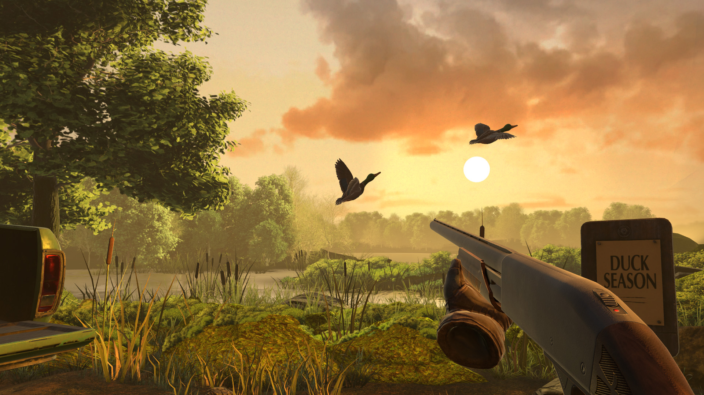

# Duck Season

<!-- reference-navigation:start -->
[← Previous: Little Nightmares · gallery](../little-nightmares/visual-reference.md) · [🖼️ Library](../../README.md) · **31 / 36** · [Next: Duck Season · gallery →](visual-reference.md)
<!-- reference-navigation:end -->

**Look for:** The familiar mascot becomes unsettling; a tone reference for optional Dexter-like transformation.

[Gallery and credits](visual-reference.md) · [Voice-note context](../../../docs/brief/voice-notes.md)

Research: 22 October 2026. Newly named audio reference; not a replacement for Vatsal's creative authority.

## Mechanics and dependencies

Stress Level Zero presents a VR game with dark undertones. The supplied screenshot matches its dog mascot. This is provisionally the intended “Duck Hunt season” spoken reference, not proof of every word in the recording.

## Worldbuilding and visual observation

The selected frames show a nostalgic room, a warm outdoor shooting scene and an oversized cheerful mascot. Familiar comfort can make a later disturbance more striking.

## Proposed WinCS experiment

Keep the original first-run game coherent, then reveal one changed detail on replay. The plush-to-humanoid idea needs its own original design; no dog mascot, branded room, gunplay or VR implementation is proposed.

## Source and production boundary

[Developer/publisher store page](https://store.steampowered.com/app/503580/). Credit: Stress Level Zero and respective publisher/rightsholders. Three official store stills were visually inspected; frame timing and full gameplay were not tested. Engine, sprite organization and internal tools are not established by this check. For our own production, use the [layer workflow](../../../docs/design/layered-stage-workflow.md); the source game's production files are not available or licensed through these screenshots.

<!-- reference-navigation:start -->
[← Previous: Little Nightmares · gallery](../little-nightmares/visual-reference.md) · [🖼️ Library](../../README.md) · **31 / 36** · [Next: Duck Season · gallery →](visual-reference.md)
<!-- reference-navigation:end -->
