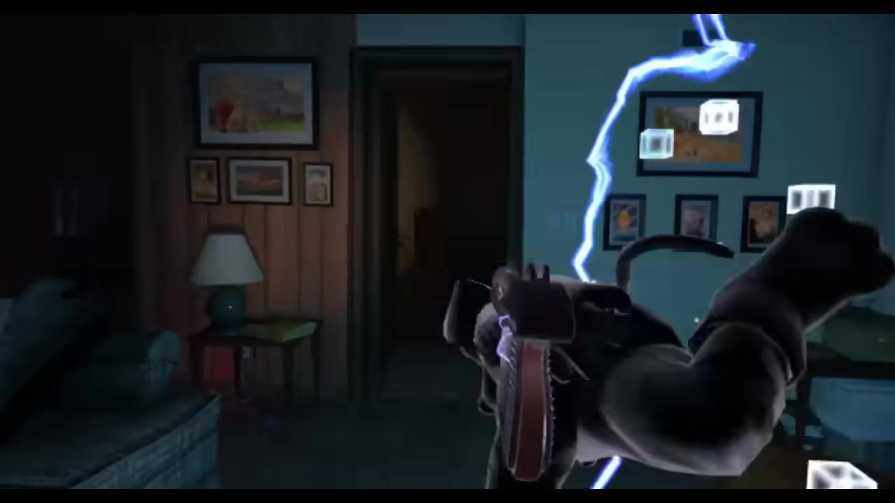
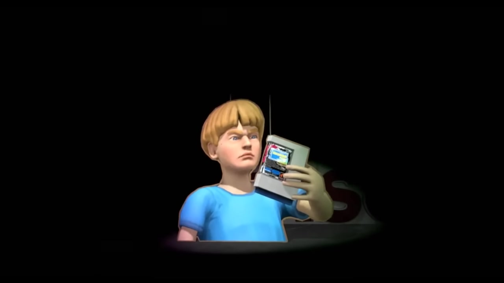
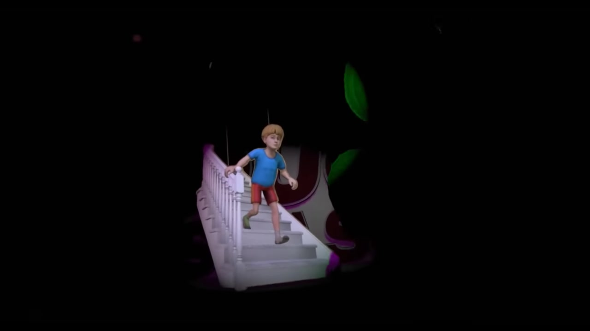
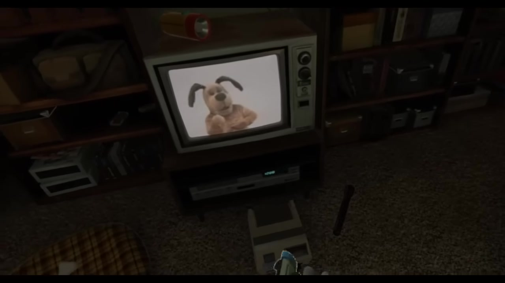

# Duck Season · visual reference

<!-- reference-navigation:start -->
[← Previous: Duck Season](README.md) · [Game index](../../README.md) · **32 / 36** · [Next: The Secret of Monkey Island · classic →](../secret-of-monkey-island/README.md)

[📍 Campus boards](../../campus/README.md) · [🎮 Game studies](../../README.md) · [🎨 Stage experiments](../../production/README.md) · [Proposal](../../../docs/proposal/campus-game.md)
<!-- reference-navigation:end -->

**Mascot escalation and ending contrasts.** Includes ending spoilers; ordinary shooting scenes have been removed from this selection.

[Game study](README.md) · [Hashes and full provenance](media-sources.json)

Selected visual research, 22 October 2026. These are existing-game references, not our concept art or runtime assets. Video frames are captured at the listed source times without browser/player overlays. A still cannot establish responsiveness or the exact timing of an attack.

## 3:20 · The dog is inside the dark living room, beyond its expected television role.

The dog is inside the dark living room, beyond its expected television role.

Credit: Stress Level Zero; gameplay recording Let's STFU and Play. [Source at 3:20](https://www.youtube.com/watch?v=aUP66wTKdXM&t=200s). Recording chapter: **Death**.

## 5:30 · The mascot occupies the room near the television and an electrical boundary.

The mascot occupies the room near the television and an electrical boundary.

Credit: Stress Level Zero; gameplay recording Let's STFU and Play. [Source at 5:30](https://www.youtube.com/watch?v=aUP66wTKdXM&t=330s). Recording chapter: **Revenge At Last**.

## 5:50 · The child is isolated with the cartridge in a dark ending tableau.

The child is isolated with the cartridge in a dark ending tableau.

Credit: Stress Level Zero; gameplay recording Let's STFU and Play. [Source at 5:50](https://www.youtube.com/watch?v=aUP66wTKdXM&t=350s). Recording chapter: **Revenge At Last**.

## 13:20 · A bright party-like ending tableau follows the threatening mascot sequences.

A bright party-like ending tableau follows the threatening mascot sequences.

Credit: Stress Level Zero; gameplay recording Let's STFU and Play. [Source at 13:20](https://www.youtube.com/watch?v=aUP66wTKdXM&t=800s). Recording chapter: **Fiesta**.

## 15:50 · The mascot is framed on the television again

The mascot is framed on the television again; context has changed after earlier intrusions.

Credit: Stress Level Zero; gameplay recording Let's STFU and Play. [Source at 15:50](https://www.youtube.com/watch?v=aUP66wTKdXM&t=950s). Recording chapter: **Dog**.

## 16:20 · The dog operates a bank of surveillance screens

The dog operates a bank of surveillance screens: a reversal of who watches whom.

Credit: Stress Level Zero; gameplay recording Let's STFU and Play. [Source at 16:20](https://www.youtube.com/watch?v=aUP66wTKdXM&t=980s). Recording chapter: **Dog**.

## Gameplay study

[Source recorder chapter guide](https://steamcommunity.com/app/503580/discussions/0/1495615865217183797/): Trapped Forever 0:00; Death 2:11; Revenge At Last 4:16; Nuke 7:18; Best Men 9:08; Fiesta 11:44; Dog 14:59. Selected frames concentrate on the mascot, altered staging and the reversal in Dog. Chapter names follow this recorder; no ending-trigger rules are asserted. A source timestamp is relative to this compilation, not in-game elapsed time.

<!-- reference-navigation:start -->
[← Previous: Duck Season](README.md) · [Game index](../../README.md) · **32 / 36** · [Next: The Secret of Monkey Island · classic →](../secret-of-monkey-island/README.md)

[📍 Campus boards](../../campus/README.md) · [🎮 Game studies](../../README.md) · [🎨 Stage experiments](../../production/README.md) · [Proposal](../../../docs/proposal/campus-game.md)
<!-- reference-navigation:end -->
