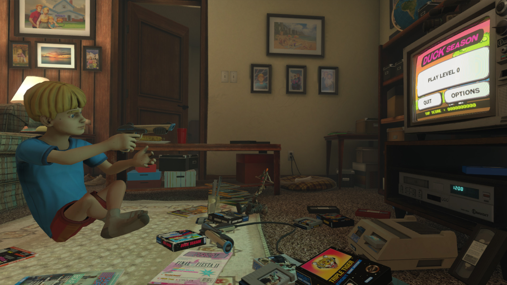
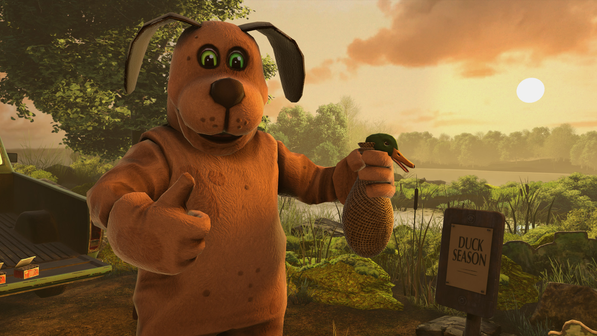

# Duck Season · visual reference

<!-- reference-navigation:start -->
[← Previous: Duck Season](README.md) · [🖼️ Library](../../README.md) · **32 / 36** · [Next: The Secret of Monkey Island: Special Edition →](../secret-of-monkey-island/README.md)
<!-- reference-navigation:end -->

**Look for:** The familiar mascot becomes unsettling; a tone reference for optional Dexter-like transformation.

[Game study](README.md) · Research 22 October 2026; official stills inspected, not a complete play session.

## Frame 1

Credit: Stress Level Zero and respective rightsholders. [Source page](https://store.steampowered.com/app/503580/) · [Original image](https://shared.akamai.steamstatic.com/store_item_assets/steam/apps/503580/ss_4357e9d4aef320b61214c9e0749130af2f71032e.1920x1080.jpg?t=1667677823)

SHA-256: `ef349edc39a7058d5ab6a795c8a691080ab14e1f0797d46a735be9d175b16a5a`. Research only; no runtime reuse license.

## Frame 2

Credit: Stress Level Zero and respective rightsholders. [Source page](https://store.steampowered.com/app/503580/) · [Original image](https://shared.akamai.steamstatic.com/store_item_assets/steam/apps/503580/ss_9c0641fe29e474cc1c61045ba97df10a447d198c.1920x1080.jpg?t=1667677823)

SHA-256: `ab3e98dbea0f548539e645a9b1365af23c3c742ba998799d71bb12d4e4826e3b`. Research only; no runtime reuse license.

## Frame 3

Credit: Stress Level Zero and respective rightsholders. [Source page](https://store.steampowered.com/app/503580/) · [Original image](https://shared.akamai.steamstatic.com/store_item_assets/steam/apps/503580/ss_ee200ad135ae23956ab2236a44afe4c7af7222a8.1920x1080.jpg?t=1667677823)

SHA-256: `9b31e1e965fd2d1bb822d94a95dea34b29252393fc25b3cd2f3785919ba711bb`. Research only; no runtime reuse license.

## Gameplay study

Use official trailers on the source page to compare scale, feedback and camera behavior. Keep observation separate from developer-pipeline claims.

<!-- reference-navigation:start -->
[← Previous: Duck Season](README.md) · [🖼️ Library](../../README.md) · **32 / 36** · [Next: The Secret of Monkey Island: Special Edition →](../secret-of-monkey-island/README.md)
<!-- reference-navigation:end -->
