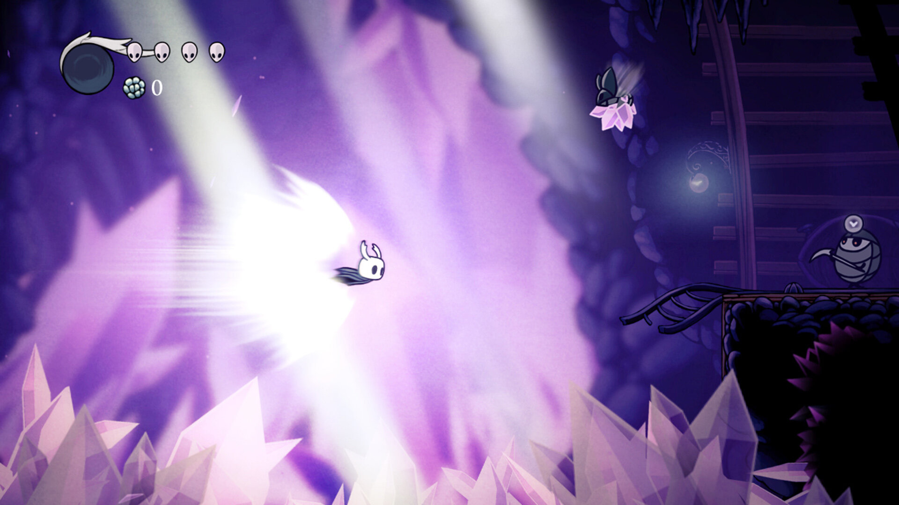
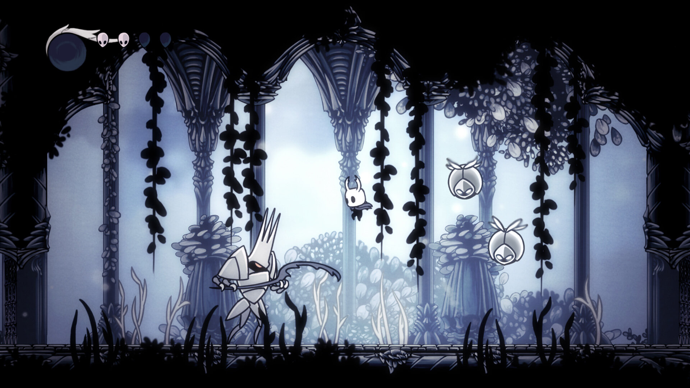

# Visual reference views

<!-- nav:start -->
[← Hollow Knight](README.md) · [Game references](../../README.md) · **2 / 36** · [9 Years of Shadows →](../9-years-of-shadows/README.md)
<!-- nav:end -->

**Look for:** The tiny bright silhouette, readable ledges and feeling of a much larger place.

[← Game study](README.md) · Credits and original sources follow each view below.

Collected 21 October 2026 from the developer or publisher's official site/store listing. These are existing copyrighted promotional/gameplay media, stored for private design analysis. No production-asset license is asserted. Do not put these files into game builds or publish the reference folder as an asset pack.

Views were visually inspected. GIF inspection showed a rendered frame; this is not a frame-by-frame timing analysis. No sprite sheets, source code or meshes were extracted. Captions are our observations and discussion prompts, not developer documentation.

## blue-cave.jpg

Vertical platform spacing and the bright character against a blue background.

- Credit: Team Cherry.
- [Official source page](https://www.hollowknight.com/).
- [Original image](https://images.squarespace-cdn.com/content/v1/606d159a953867291018f801/6cdafaab-e95a-49c7-a045-4f21469bb327/Blue_Cave.jpg).
- Local SHA-256: `bef0fd91f24d2cc518a2c199ce8e744dae3d6c9c3d9c677a67b8f962d356579d`.

## mines.jpg

Horizontal movement, a landing ledge, hazards below and effects competing for contrast.

- Credit: Team Cherry.
- [Official source page](https://www.hollowknight.com/).
- [Original image](https://images.squarespace-cdn.com/content/v1/606d159a953867291018f801/3d8baa3e-5b8a-4c13-9747-4e89fb6ed0e6/mines.jpg).
- Local SHA-256: `25cecf4afb47b3ab957848c1ec52890a9c10d3ef926ac5edb24a745f48f45a08`.

## white-palace.jpg

Enemy scale and ground combat silhouette against layered architecture. Source filename retained; location identity is not inferred.

- Credit: Team Cherry.
- [Official source page](https://www.hollowknight.com/).
- [Original image](https://images.squarespace-cdn.com/content/v1/606d159a953867291018f801/64008652-cc73-42e3-a001-b65f33c0471b/white%2Bpalace.jpg).
- Local SHA-256: `430d7184a9418aa95ac587fecd230c9552e8d6705bf41f36a0cb3c124975ef9e`.

## Review with Vatsal and Lex

Choose one view and name the exact quality you want: camera scale, readable terrain, color mood, animation economy or interaction feedback. Then identify one quality to omit. A still cannot establish movement feel, input latency or exact animation timing; use the README's gameplay sources or a played session for those questions.

<!-- nav:start -->
[← Hollow Knight](README.md) · [Game references](../../README.md) · **2 / 36** · [9 Years of Shadows →](../9-years-of-shadows/README.md)
<!-- nav:end -->
