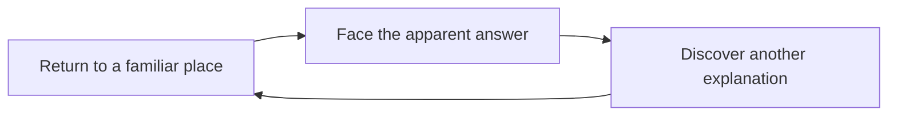

# Infinity Blade · replay changes what you know

<!-- reference-navigation:start -->
[← Previous: The Secret of Monkey Island: Special Edition · gallery](../secret-of-monkey-island/visual-reference.md) · [🖼️ Library](../../README.md) · **35 / 36** · [Next: Infinity Blade · gallery →](visual-reference.md)
<!-- reference-navigation:end -->

**Story structure reference, not the visual style for WinCS.** The diagram is our analysis, not an image or map from the game.

Alexander names the series in A05 as a reference for revealing story and lore across returns. Epic/ChAIR's official universe page describes repeated journeys and later revelations that reinterpret earlier events. A compact campus version could change one landmark or encounter after the first completion, without reproducing the series' plot or characters.

**Mechanic dependency:** a replay needs a completed-state flag, an intentional reset contract and changed content worth seeing. It does not require persistent statistics, generations, a loot economy or several endings.

**Worldbuilding interpretation:** returning with new understanding can provide depth without large exposition dumps. The proposed first-slice ending must still stand on its own; a secret cannot substitute for a complete initial game.

[Official story/universe page](https://www.epicgames.com/infinityblade/en-US/game-info/infinity-blade-universe) · [Visual/source notes](visual-reference.md). Checked 22 October 2026. Engine and internal production pipeline were not investigated here. Epic's linked CDN image returned HTTP 403, so it was not copied or bypassed. No screenshot is claimed.

<!-- reference-navigation:start -->
[← Previous: The Secret of Monkey Island: Special Edition · gallery](../secret-of-monkey-island/visual-reference.md) · [🖼️ Library](../../README.md) · **35 / 36** · [Next: Infinity Blade · gallery →](visual-reference.md)
<!-- reference-navigation:end -->
