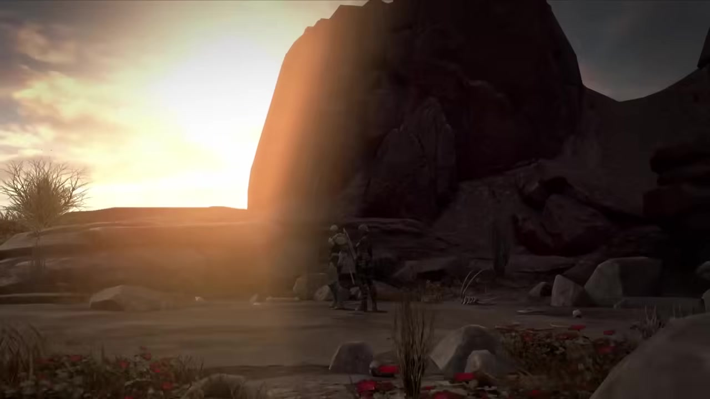
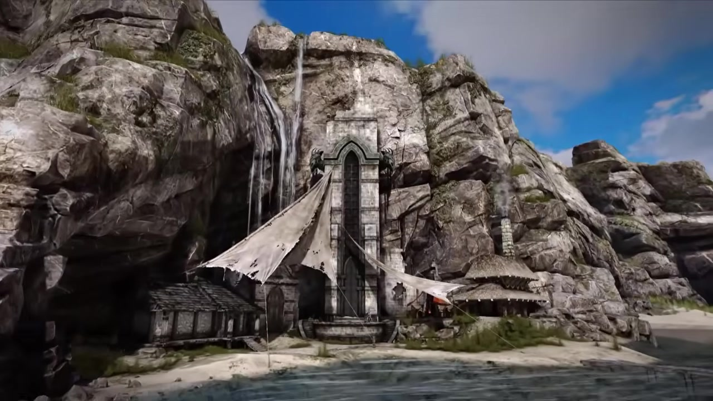
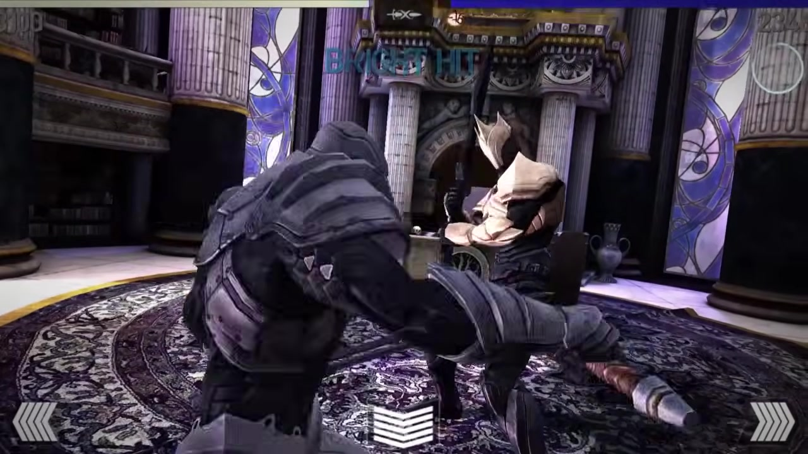
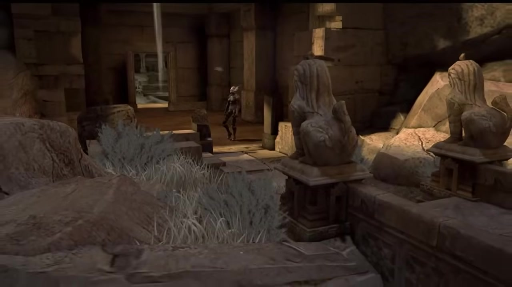
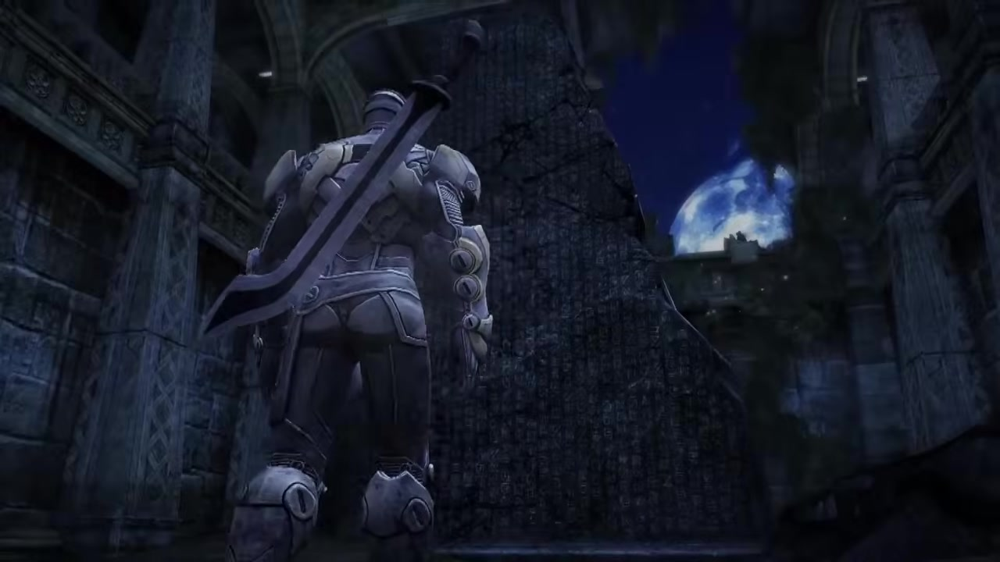

# Infinity Blade · visual reference

<!-- nav:start -->
[← Infinity Blade · technology remembered as myth](README.md) · [Game references](../../README.md) · **36 / 36** · [Reference games →](../../README.md)
<!-- nav:end -->

**Ancient, monumental, mechanical, mysterious.** All six local captures are from Infinity Blade III; the intended civilization concept spans the trilogy.

[Game study](README.md) · [Hashes and full provenance](media-sources.json)

Selected visual research, 22 October 2026. These are existing-game references, not our concept art or runtime assets. Video frames are captured at the listed source times without browser/player overlays. A still cannot establish responsiveness or the exact timing of an attack.

## 0:08 · A monumental circular mechanism embedded in a heavy architectural enclosure.

A monumental circular mechanism embedded in a heavy architectural enclosure.

Credit: Epic Games / ChAIR. [Source at 0:08](https://www.youtube.com/watch?v=zh0bVa9waXM&t=8s).

## 0:16 · Vast rocky remains dwarf the figure

Vast rocky remains dwarf the figure; ancient mass takes priority over modern panels.

Credit: Epic Games / ChAIR. [Source at 0:16](https://www.youtube.com/watch?v=zh0bVa9waXM&t=16s).

## 0:24 · A fortified temple/castle grows into the cliff face.

A fortified temple/castle grows into the cliff face.

Credit: Epic Games / ChAIR. [Source at 0:24](https://www.youtube.com/watch?v=zh0bVa9waXM&t=24s).

## 1:04 · Stone ornament and concentrated violet light share the same chamber.

Stone ornament and concentrated violet light share the same chamber.

Credit: Epic Games / ChAIR. [Source at 1:04](https://www.youtube.com/watch?v=zh0bVa9waXM&t=64s).

## 1:20 · A long stone gallery repeats massive columns and weathered surfaces.

A long stone gallery repeats massive columns and weathered surfaces.

Credit: Epic Games / ChAIR. [Source at 1:20](https://www.youtube.com/watch?v=zh0bVa9waXM&t=80s).

## 1:28 · A bulky armored figure stands inside a gothic stone hall under concentrated blue light.

A bulky armored figure stands inside a gothic stone hall under concentrated blue light.

Credit: Epic Games / ChAIR. [Source at 1:28](https://www.youtube.com/watch?v=zh0bVa9waXM&t=88s).

## Gameplay study

[Official trilogy universe page](https://www.epicgames.com/infinityblade/en-US/game-info/infinity-blade-universe) · [III launch trailer](https://www.youtube.com/watch?v=zh0bVa9waXM). Compare stone architecture with embedded mechanisms and concentrated light. The interpretation that a society mistakes technology for magic comes from Alexander’s supplied worldbuilding direction; a glowing image alone cannot establish that lore.

<!-- nav:start -->
[← Infinity Blade · technology remembered as myth](README.md) · [Game references](../../README.md) · **36 / 36** · [Reference games →](../../README.md)
<!-- nav:end -->
