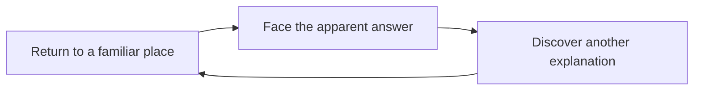

# Infinity Blade · source and story diagram

<!-- reference-navigation:start -->
[← Previous: Infinity Blade](README.md) · [🖼️ Library](../../README.md) · **36 / 36** · [Next: Compare the games →](../../comparison.md)
<!-- reference-navigation:end -->

**Look for:** how revisiting a place can change its meaning. This is an authored explanatory diagram, not game concept art or a screenshot.

[Back to study](README.md) · [Official universe page](https://www.epicgames.com/infinityblade/en-US/game-info/infinity-blade-universe).

The official page contains story illustrations, credited to Epic Games / ChAIR. The linked CDN illustration returned HTTP 403 during this research on 22 October 2026. No local image was obtained and no access restriction was bypassed. Consult the source page for those illustrations. They are not runtime assets.

## Gameplay study

This reference concerns narrative repetition. A later play study should distinguish combat mechanics from the story-cycle reference before either enters WinCS scope.

<!-- reference-navigation:start -->
[← Previous: Infinity Blade](README.md) · [🖼️ Library](../../README.md) · **36 / 36** · [Next: Compare the games →](../../comparison.md)
<!-- reference-navigation:end -->
