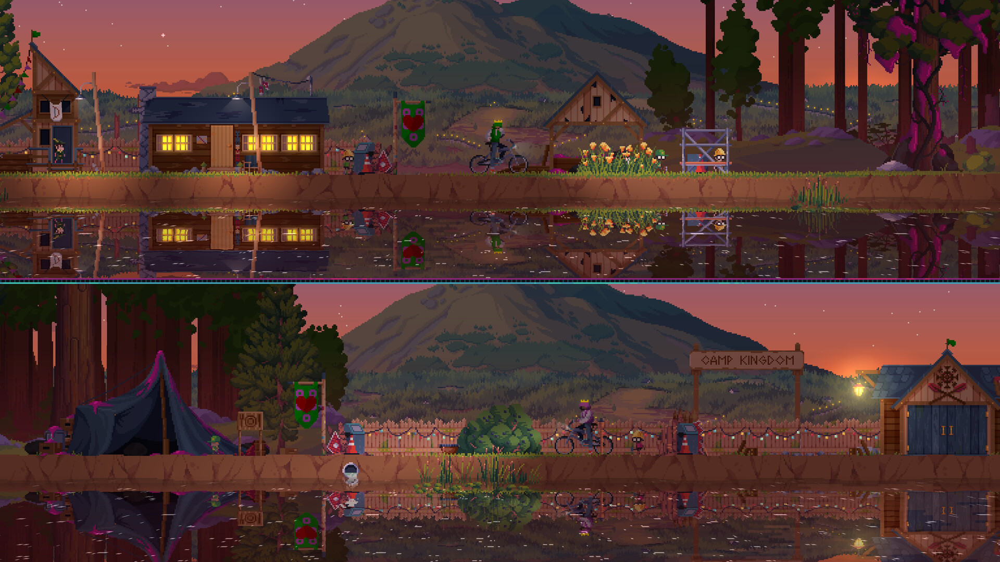
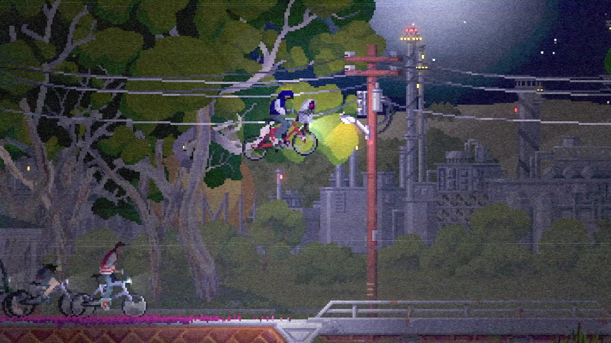

# Visual reference views

Collected 21 October 2026 from the developer/publisher store listing. Visually inspected in a contact sheet; these are composition observations, not timing or source-pipeline analysis. Copyright remains with the credited rightsholders. Private research only; no runtime reuse license.

## images/01-official-gameplay.jpg

Split-screen co-op promotional gameplay view: compare repeated horizontal strips.

- Credit: Fury Studios / Raw Fury.
- [Source page](https://store.steampowered.com/app/1956040/).
- [Original image](https://shared.akamai.steamstatic.com/store_item_assets/steam/apps/1956040/ss_2f7f423a053b6c4fa92035bc2b5c925e18f6f245.1920x1080.jpg?t=1792068216).
- SHA-256: `ea9f7efa8887c2b2b7157fd215c9bacbfd8e46bce96c955d79f1ed43b5991348`.

## images/02-official-gameplay.jpg

Side-view neighborhood composition with cables, tree canopy and bicycle.

- Credit: Fury Studios / Raw Fury.
- [Source page](https://store.steampowered.com/app/1956040/).
- [Original image](https://shared.akamai.steamstatic.com/store_item_assets/steam/apps/1956040/ss_611e0f0f9bb3a1a24d37a6cd3f01fd637a59a6ce.1920x1080.jpg?t=1792068216).
- SHA-256: `baad060b8917bae01b184e1e5d6482fdec0601ec1ffdfdb35a8312f35b7b10bf`.

## images/03-official-gameplay.jpg

Side-view group near an ordinary building; reflections reinforce a single ground line.

- Credit: Fury Studios / Raw Fury.
- [Source page](https://store.steampowered.com/app/1956040/).
- [Original image](https://shared.akamai.steamstatic.com/store_item_assets/steam/apps/1956040/ss_712e19bbaf8284fe07b0783f5d1f8e3008e6d0ce.1920x1080.jpg?t=1792068216).
- SHA-256: `6de35521e2434d9737aa4250f68897452d1d48dbedce93618f91d10837d552ab`.

## Gameplay study

Use official trailers on the source page to compare camera behavior, movement, transitions and visual feedback. Still images cannot establish responsiveness. See media-sources.json for the named trailer inventory where available.
