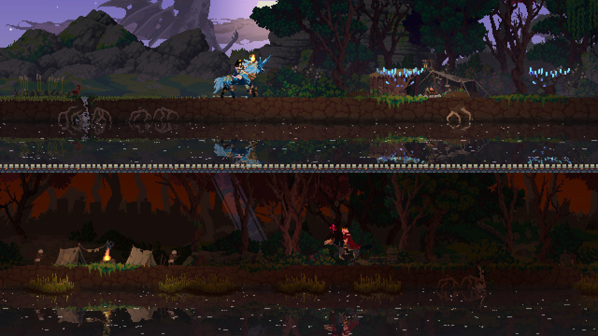
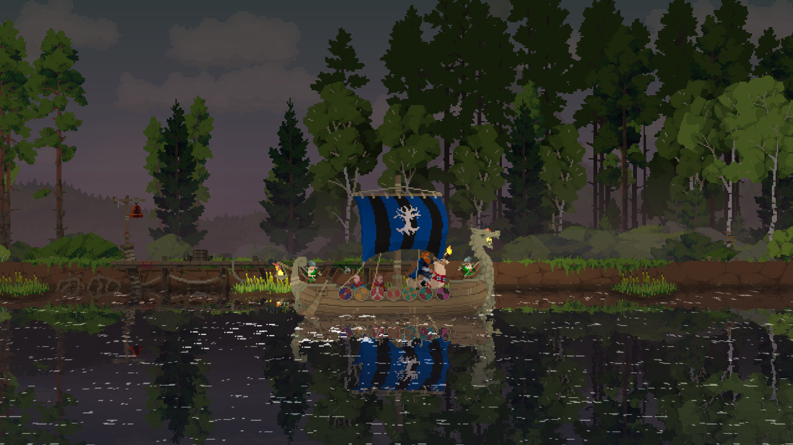

# Visual reference views

Collected 21 October 2026 from the developer/publisher store listing. Visually inspected in a contact sheet; these are composition observations, not timing or source-pipeline analysis. Copyright remains with the credited rightsholders. Private research only; no runtime reuse license.

## images/01-official-gameplay.jpg

Nighttime side-view scene: threats, recruited people and warm light on one strip.

- Credit: Fury Studios, Coatsink / Raw Fury.
- [Source page](https://store.steampowered.com/app/701160/).
- [Original image](https://shared.akamai.steamstatic.com/store_item_assets/steam/apps/701160/ss_ca9df45386d8ead4a0cf62a16c2524095a610f6c.1920x1080.jpg?t=1791479063).
- SHA-256: `b030f5e6598bfc6636c9cc2e4b3225890e9c53f6eb6ce5978c40dbbef5af411e`.

## images/02-official-gameplay.jpg

Split-screen co-op view, not two vertically connected world floors.

- Credit: Fury Studios, Coatsink / Raw Fury.
- [Source page](https://store.steampowered.com/app/701160/).
- [Original image](https://shared.akamai.steamstatic.com/store_item_assets/steam/apps/701160/ss_fb33eeb33590f492c39c714fd673e059599895a5.1920x1080.jpg?t=1791479063).
- SHA-256: `3485ebeb9d951cd2889d1727dadbf30a3ce2778e218141e310e0c9c47b83e6aa`.

## images/03-official-gameplay.jpg

Daylight forest shrine/landmark: foreground silhouette and water reflection.

- Credit: Fury Studios, Coatsink / Raw Fury.
- [Source page](https://store.steampowered.com/app/701160/).
- [Original image](https://shared.akamai.steamstatic.com/store_item_assets/steam/apps/701160/ss_7b16a9ab8f9498ec1a28507120ab3ae7eb7c7217.1920x1080.jpg?t=1791479063).
- SHA-256: `922e470a162c5b50642f2874dca1f103b5c48ed55e393b21ba8fa67ac8d30f1d`.

## Gameplay study

Use official trailers on the source page to compare camera behavior, movement, transitions and visual feedback. Still images cannot establish responsiveness. See media-sources.json for the named trailer inventory where available.
