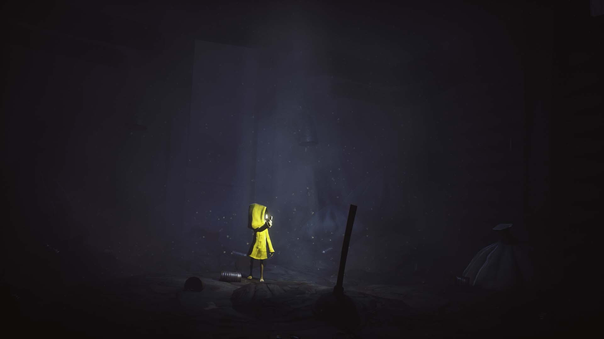
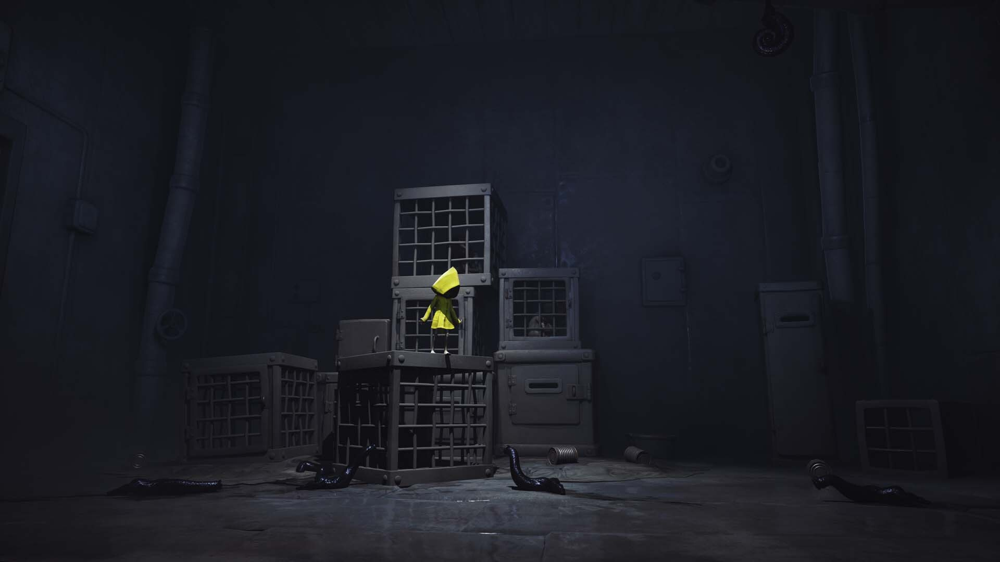
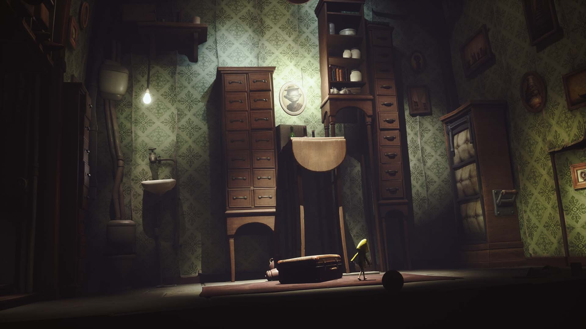

# Little Nightmares · visual reference

<!-- reference-navigation:start -->
[← Previous: Little Nightmares](README.md) · [🖼️ Library](../../README.md) · **30 / 36** · [Next: Duck Season →](../duck-season/README.md)
<!-- reference-navigation:end -->

**Look for:** A small vulnerable figure against oversized, threatening surroundings.

[Game study](README.md) · Research 22 October 2026; official stills inspected, not a complete play session.

## Frame 1

Credit: Tarsier Studios and respective rightsholders. [Source page](https://store.steampowered.com/app/424840/) · [Original image](https://shared.akamai.steamstatic.com/store_item_assets/steam/apps/424840/8942672a817424d426e65ade0253e428a3f449ee/ss_8942672a817424d426e65ade0253e428a3f449ee.1920x1080.jpg?t=1773135169)

SHA-256: `48a7a0d8e0605e03a07d8b0bc9673b06a9b267e40df3b1fa78855780bac0d3e0`. Research only; no runtime reuse license.

## Frame 2

Credit: Tarsier Studios and respective rightsholders. [Source page](https://store.steampowered.com/app/424840/) · [Original image](https://shared.akamai.steamstatic.com/store_item_assets/steam/apps/424840/659c0e9407e6886ed3e27320db598274c0e352a2/ss_659c0e9407e6886ed3e27320db598274c0e352a2.1920x1080.jpg?t=1773135169)

SHA-256: `7c5b61e4ee69645699eafc04ebe07a1f4b66419cec4e57af5f0b584db6c4a658`. Research only; no runtime reuse license.

## Frame 3

Credit: Tarsier Studios and respective rightsholders. [Source page](https://store.steampowered.com/app/424840/) · [Original image](https://shared.akamai.steamstatic.com/store_item_assets/steam/apps/424840/24d7518ab72df4608de04f4ad4bc04ee479e3911/ss_24d7518ab72df4608de04f4ad4bc04ee479e3911.1920x1080.jpg?t=1773135169)

SHA-256: `068e59c80012088f74fee8448e6e35c618d75e33353bdfb3d0ca97a9c5a3e5f9`. Research only; no runtime reuse license.

## Gameplay study

Use official trailers on the source page to compare scale, feedback and camera behavior. Keep observation separate from developer-pipeline claims.

<!-- reference-navigation:start -->
[← Previous: Little Nightmares](README.md) · [🖼️ Library](../../README.md) · **30 / 36** · [Next: Duck Season →](../duck-season/README.md)
<!-- reference-navigation:end -->
