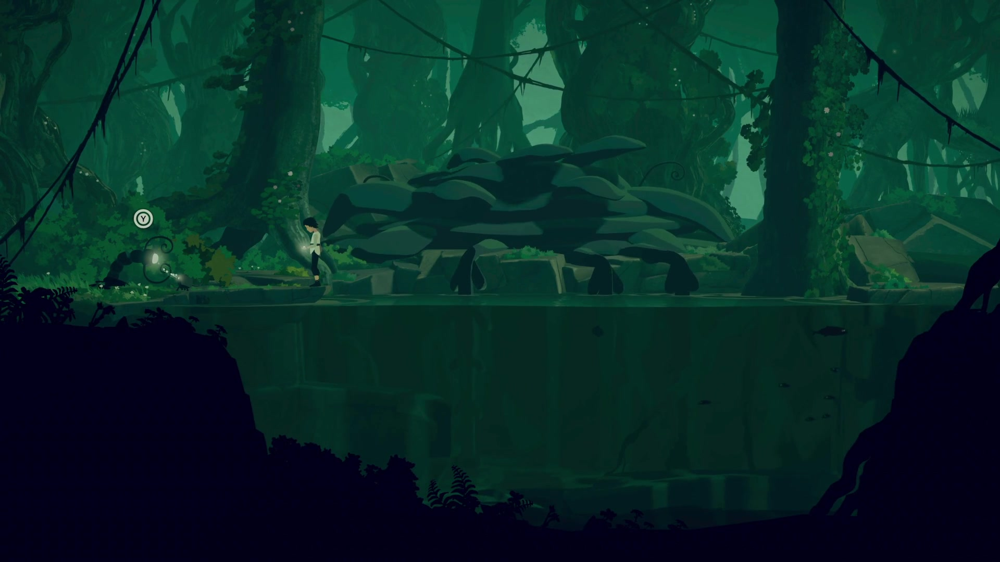

# Planet of Lana · soft terrain and layered depth

<!-- nav:start -->
[← Visual reference views](../children-of-morta/visual-reference.md) · [Game references](../../README.md) · **23 / 36** · [Planet of Lana · visual reference →](visual-reference.md)
<!-- nav:end -->

**Borrow the flowing silhouettes, horizontal composition and separated depth, then translate them into our own pixel-art language.**

[More pictures and credits](visual-reference.md) · [Compare references](../../../docs/research/what-we-love.md)

[Six gameplay frames, five developer-supplied art views and two animated process demonstrations](visual-reference.md) · **[How the layers work, and our proposed translation](layers-and-motion.md)**

The original is a **hand-painted 2D/3D hybrid**, not a pixel-art production pipeline. That distinction supports your goal: a pixel game can still have curved banks, irregular cliffs and unrestricted stage silhouettes. Pixel density describes the image; collision and world geometry are separate choices.

## What is verified

Wishfully's developer interview describes Photoshop concept art, Unity, layered elements with some modeled depth, Maya LT work and a custom wind system. This is a mixture of painting and 3D techniques, rather than evidence that every tree is a flat mask. See the [developer interview](https://www.gamedeveloper.com/business/exploring-the-art-and-animation-behind-hand-painted-odyssey-i-planet-of-lana-i-) and the more precise [layer analysis](layers-and-motion.md).

## What we can use

For Hidden Garden: a broad lake reveal; soft bank profiles; distant canopy separated from near reeds; the player on a stable collision plane; small local water/vegetation motion. For the creek: repeated grassy troughs and partly screened paths create uncertainty while the landing surface stays readable.

Companion puzzles, stealth AI and cinematic transitions are not baseline requirements. A beautiful long strip must still serve a complete small route, safe retry and an ending.

Research updated 22 October 2026. Observations and WinCS translations below are design analysis, not extracted development files or accepted game requirements. Reference media remains with its credited rightsholders; no runtime reuse license is inferred.

<!-- nav:start -->
[← Visual reference views](../children-of-morta/visual-reference.md) · [Game references](../../README.md) · **23 / 36** · [Planet of Lana · visual reference →](visual-reference.md)
<!-- nav:end -->
