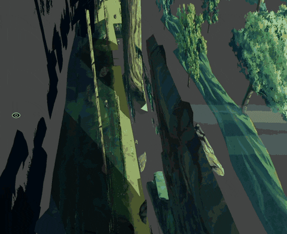
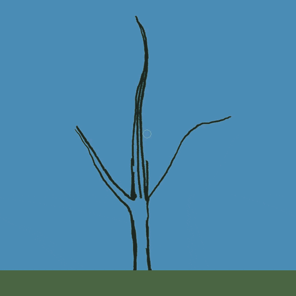
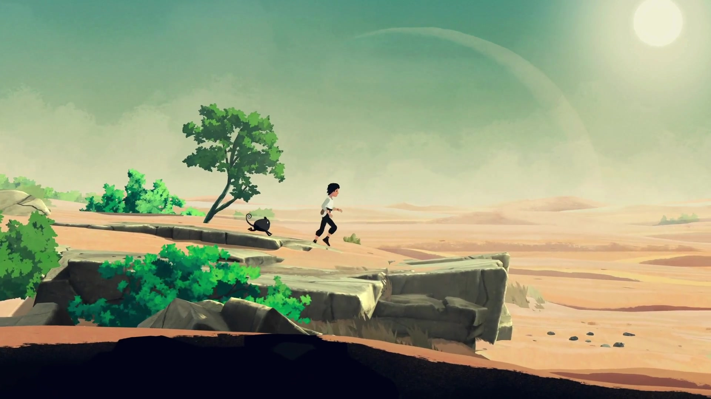

# A painting with depth · translating Planet of Lana

[← Game study](README.md) · [Full visual gallery](visual-reference.md) · [Our stage workflow →](../../../docs/design/layered-stage-workflow.md)

**This is a real developer demonstration, not our reconstruction.** Credit: Wishfully; [developer interview and original demonstration](https://www.gamedeveloper.com/business/exploring-the-art-and-animation-behind-hand-painted-odyssey-i-planet-of-lana-i-). Full source URLs and hashes are in [the media manifest](media-sources.json).

**WinCS production update, 23 October:** these depth bands are a visual analysis, not a request to reconstruct a scene from independent assets. Our [current workflow](../../../docs/design/layered-stage-workflow.md) composes/edits the whole image first, then derives only necessary aligned plates/props.

## Verified process, then our interpretation

In the 2021 interview, Wishfully describes hand-painted textures, some projected onto planes and given shallow modeled depth. The studio names Unity, Maya LT for characters/environment work, Maya for some baked lighting, Photoshop concept painting, and a custom wind system. The original is a hand-painted hybrid; it is not evidence for a pixel-art pipeline or an entirely flat-mask renderer. This is historical development evidence, not a claim that every shipped scene uses identical techniques.

The second published demonstration moves from tree construction/painting to an animated tree. The small changing foliage silhouette is local animation; it is a different effect from a whole depth plane moving against the camera. The exact deformation algorithm, mask channels and wind parameters are not disclosed here.

## Read one landscape as depth bands

**Our visual decomposition**, based on the official Gameplay Trailer at 0:35, not extracted source layers:

| From far to near | What we can see | Proposed Hidden Garden equivalent |
| --- | --- | --- |
| Atmospheric background | Lower contrast and broad light behind vegetation | Quiet sky and distant campus/tree silhouettes |
| Distant scene masses | Trees and banks behind the pool | Opposite bank, distant reeds and willow masses |
| Middle structure | Trunks, water edge and local gaps | Main lake composition and landmarks |
| Play plane | Small player aligned to a continuous surface | Hand-authored bank, safe landings and lake anchor |
| Front framing | Darker nearby trunks/foliage overlapping the view | A few reeds/branches, kept clear of required cues |
| Local light/motion | Reflections and vegetation suggest a living place | One shimmer region, one reed sway, sparse leaves |

A painted reflection does not imply a simulated second world. Our lake transition needs explicit authored state and safe spawn rules even if the art looks mirrored.

## Curves in pixels; geometry in the controller

A contour can slope, round out, break into a cliff and curve again without being assembled from square tiles. Pixel art samples that silhouette at the chosen density; it does not decide the underlying collision. The [classic Monkey Island views](../secret-of-monkey-island/visual-reference.md) are a complementary pixel-contour study.

**Proposed route contract:** sketch a height profile with a few broad slopes, explicit cliff breaks and generous flat landing/interaction patches. Paint grass and roots around that profile. In the greybox, test slope adhesion, feet position and jump recovery before locking the final ground. Tiny decorative bumps need not become physical steps. A physics engine with poor slope support is a reason to change the route or controller early, not to trace every alpha pixel into a collider.

## How we can get the effect cheaply

Use separate strips with one shared scene origin. For a plane with factor `p`, a basic horizontal draw coordinate is `worldX - cameraX * p`: distant bands move less; the play plane uses `p = 1`; an optional front band can move slightly more. These factors are our proposed technique, **not measured Planet of Lana settings**. Character, props, ground and collision must share the play-plane transform.

Keep enough offscreen image coverage for the full camera range. Near framing can be separate props instead of a huge full-width texture. No 3D engine is required to test this effect. Shallow 3D and dynamic lighting remain optional costs, not prerequisites.

Water shimmer, a reed loop and drifting leaves are separate local effects. A cloud strip can drift slowly within its layer; parallax alone does not make clouds move through the world. For an isolated moving tree, remove the static duplicate and provide a clean plate behind it.

## Review before making a long strip

1. At final camera scale, approve one bank, lake, tree, student silhouette and interaction prop in a consistent pixel treatment.
2. Test a short greybox with gentle slopes, a cliff, a gap, a flat interaction patch and a safe retry.
3. Compose the Hidden Garden master around that route, then separate depth and limited FX.
4. Move the camera through every seam and direction; check framing, feet, occlusion and empty edges. Do not infer successful motion from a still image.

The local footage captures are selected samples of the official Gameplay Trailer (Steam movie 256891854), not a frame-by-frame pipeline audit. Published demonstrations substantiate depth/wind; our table, coordinate formula, collision plan and production budget are independent proposals.

[← Game study](README.md) · [Full visual gallery](visual-reference.md) · [Our stage workflow →](../../../docs/design/layered-stage-workflow.md)
