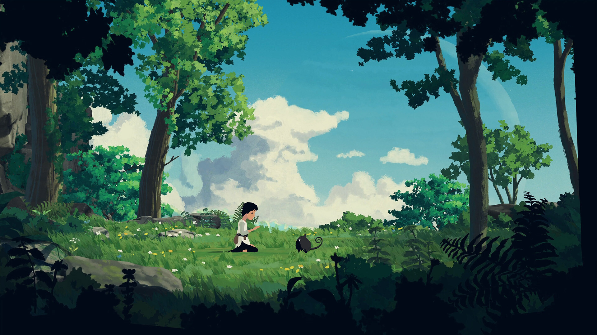
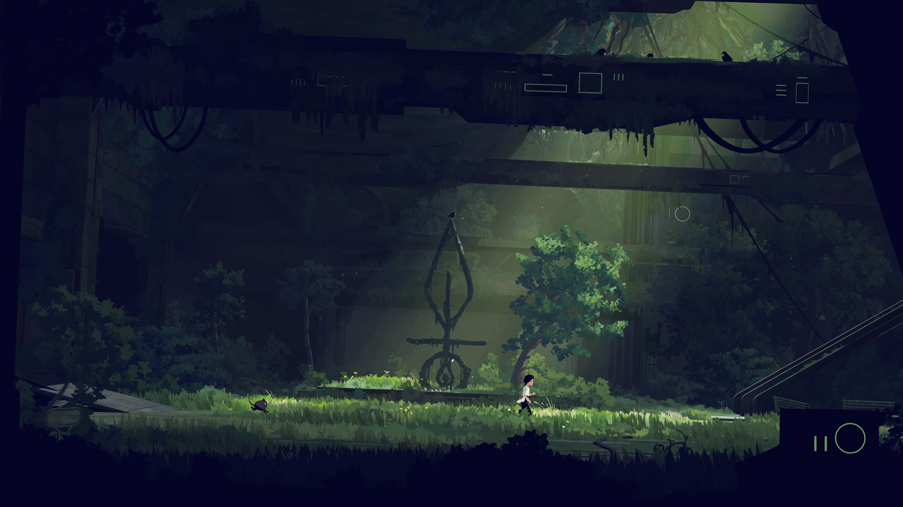
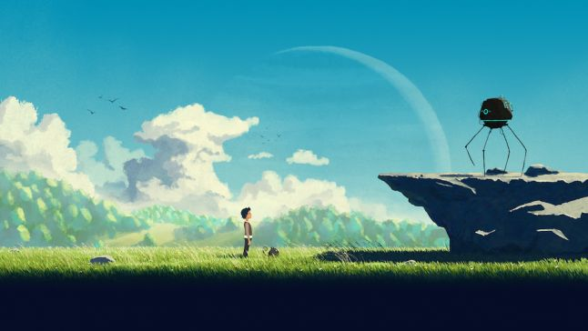
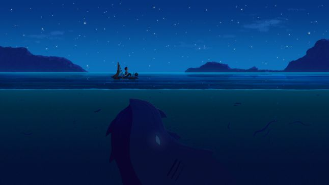
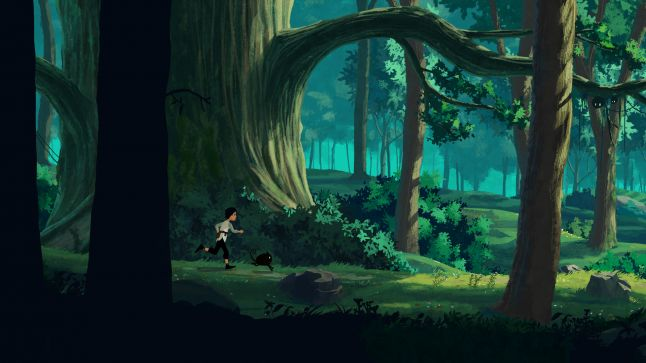
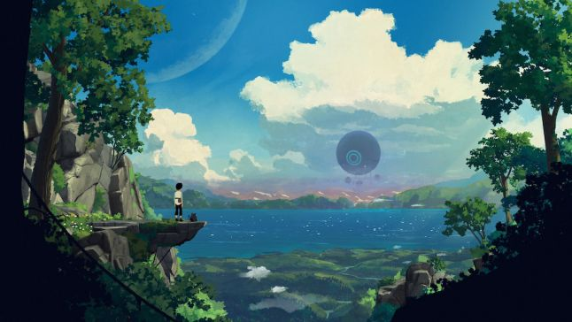
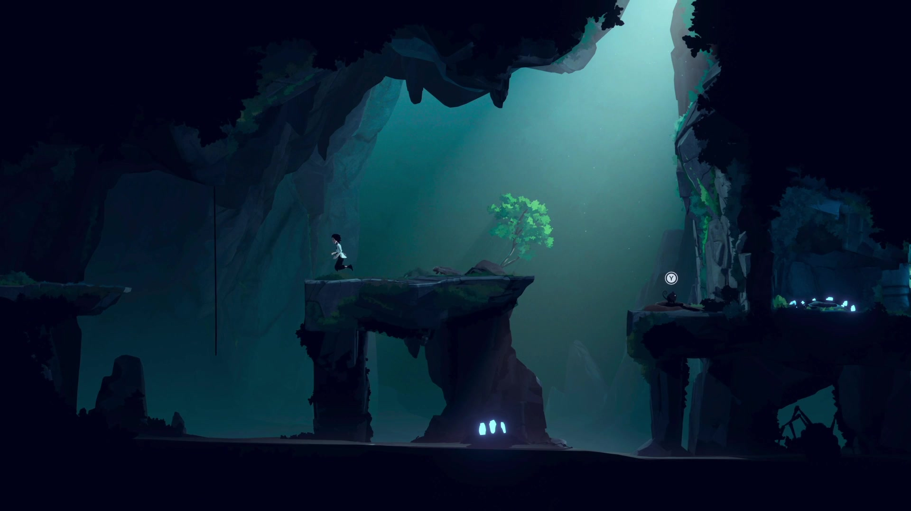
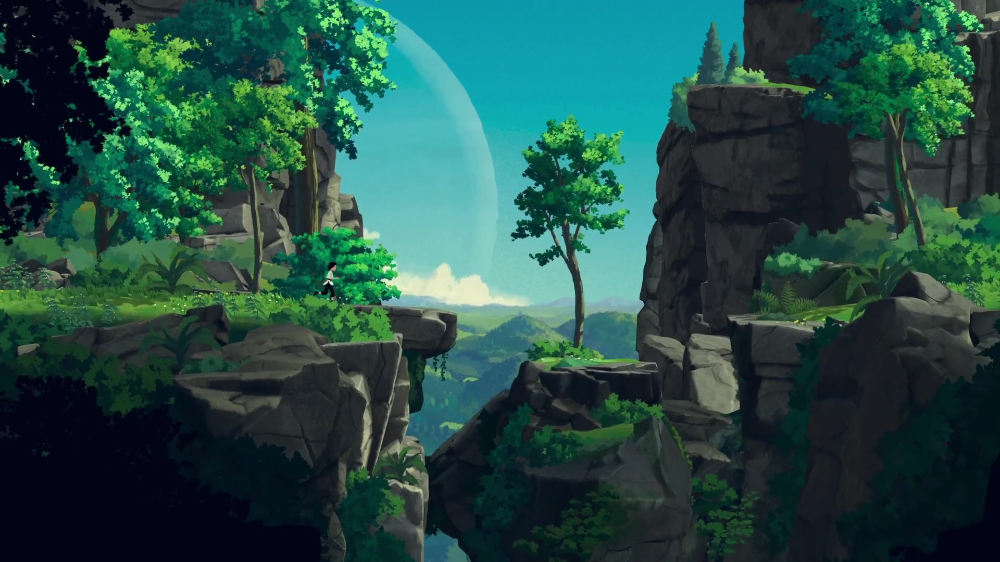
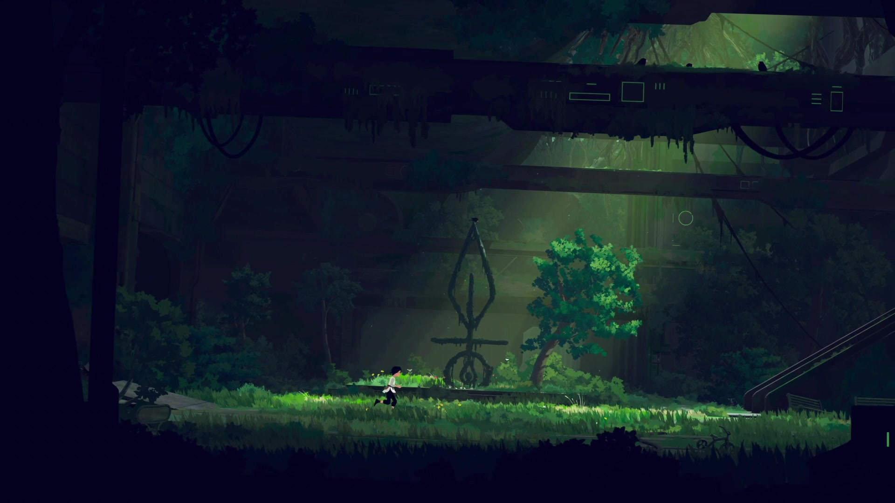
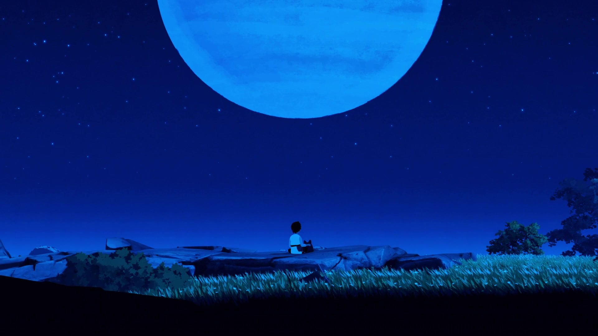

# Planet of Lana · visual reference

<!-- reference-navigation:start -->
[← Previous: Planet of Lana](README.md) · [Game index](../../README.md) · **24 / 36** · [Next: Dead Cells →](../dead-cells/README.md)

[📍 Campus boards](../../campus/README.md) · [🎮 Game studies](../../README.md) · [🎨 Stage experiments](../../production/README.md) · [Proposal](../../../docs/proposal/campus-game.md)
<!-- reference-navigation:end -->

**Follow the contour and depth bands.** Developer art and gameplay frames are labeled separately; none are extracted runtime layers.

[Game study](README.md) · [Hashes and full provenance](media-sources.json)

Selected visual research, 22 October 2026. These are existing-game references, not our concept art or runtime assets. Video frames are captured at the listed source times without browser/player overlays. A still cannot establish responsiveness or the exact timing of an attack.

## Wide landscape with tiny character, depth and a legible crossing.

Wide landscape with tiny character, depth and a legible crossing.

Credit: Wishfully / Thunderful Publishing. [Source](https://store.steampowered.com/app/1608230/).

## Quiet forest clearing

Quiet forest clearing: negative space and companion scale guide attention.

Credit: Wishfully / Thunderful Publishing. [Source](https://store.steampowered.com/app/1608230/).

## Dark machine interior

Dark machine interior: local lighting picks out a route and interaction.

Credit: Wishfully / Thunderful Publishing. [Source](https://store.steampowered.com/app/1608230/).

## Developer art 01

Developer style image: sunlit grass and a cliff use broad soft contours around a tiny figure.

Credit: Wishfully / Thunderful; art supplied with developer interview. [Source](https://www.gamedeveloper.com/business/exploring-the-art-and-animation-behind-hand-painted-odyssey-i-planet-of-lana-i-).

## Developer art 02

Developer style image: a beach and huge machine legs contrast natural shapes with monumental engineering.

Credit: Wishfully / Thunderful; art supplied with developer interview. [Source](https://www.gamedeveloper.com/business/exploring-the-art-and-animation-behind-hand-painted-odyssey-i-planet-of-lana-i-).

## Developer art 03

Developer style image: a small night boat sits above dark underwater shapes; depth carries the reveal.

Credit: Wishfully / Thunderful; art supplied with developer interview. [Source](https://www.gamedeveloper.com/business/exploring-the-art-and-animation-behind-hand-painted-odyssey-i-planet-of-lana-i-).

## Developer art 04

Developer forest concept: overlapping trunks, canopy and front framing create several distinct depth bands.

Credit: Wishfully / Thunderful; art supplied with developer interview. [Source](https://www.gamedeveloper.com/business/exploring-the-art-and-animation-behind-hand-painted-odyssey-i-planet-of-lana-i-).

## Developer art 05

Developer-supplied landscape image: irregular rocks, water, sky and clouds form a wide horizontal composition.

Credit: Wishfully / Thunderful; art supplied with developer interview. [Source](https://www.gamedeveloper.com/business/exploring-the-art-and-animation-behind-hand-painted-odyssey-i-planet-of-lana-i-).

## 0:20 · Sunlit sandy profile and irregular rock edges

Sunlit sandy profile and irregular rock edges; the walking silhouette can curve without using terrain tiles.

Credit: Wishfully / Thunderful. [Source at 0:20](https://store.steampowered.com/app/1608230/).

## 0:35 · Pool, tree trunks and reflected vegetation separate into distinct depth bands.

Pool, tree trunks and reflected vegetation separate into distinct depth bands.

Credit: Wishfully / Thunderful. [Source at 0:35](https://store.steampowered.com/app/1608230/).

## 0:50 · Cave openings, platforms and a shaft of light organize the route.

Cave openings, platforms and a shaft of light organize the route.

Credit: Wishfully / Thunderful. [Source at 0:50](https://store.steampowered.com/app/1608230/).

## 1:05 · Rock canopy frames a gap

Rock canopy frames a gap; negative space makes the crossing visible.

Credit: Wishfully / Thunderful. [Source at 1:05](https://store.steampowered.com/app/1608230/).

## 1:20 · Mossy playable ground sits before a massive machine-like interior.

Mossy playable ground sits before a massive machine-like interior.

Credit: Wishfully / Thunderful. [Source at 1:20](https://store.steampowered.com/app/1608230/).

## 1:50 · A quiet night field uses a broad sky and low foreground to preserve the small silhouette.

A quiet night field uses a broad sky and low foreground to preserve the small silhouette.

Credit: Wishfully / Thunderful. [Source at 1:50](https://store.steampowered.com/app/1608230/).

## Developer depth demonstration

Developer depth demonstration: a forest scene assembled from painted elements on shallow geometry.

Credit: Wishfully; developer demonstration accompanying the Game Developer interview. [Source](https://www.gamedeveloper.com/business/exploring-the-art-and-animation-behind-hand-painted-odyssey-i-planet-of-lana-i-).

## Developer process demonstration

Developer process demonstration: painting a tree and bringing it to life with wind.

Credit: Wishfully; developer demonstration accompanying the Game Developer interview. [Source](https://www.gamedeveloper.com/business/exploring-the-art-and-animation-behind-hand-painted-odyssey-i-planet-of-lana-i-).

## Gameplay study

[Layer and motion study](layers-and-motion.md). Six timecoded captures sample the official Gameplay Trailer (Steam movie 256891854). Camera-relative motion and local animation are different; a still does not establish parallax speed. Treat the depth split as our reconstruction, while the developer interview establishes the hybrid production approach.

<!-- reference-navigation:start -->
[← Previous: Planet of Lana](README.md) · [Game index](../../README.md) · **24 / 36** · [Next: Dead Cells →](../dead-cells/README.md)

[📍 Campus boards](../../campus/README.md) · [🎮 Game studies](../../README.md) · [🎨 Stage experiments](../../production/README.md) · [Proposal](../../../docs/proposal/campus-game.md)
<!-- reference-navigation:end -->
