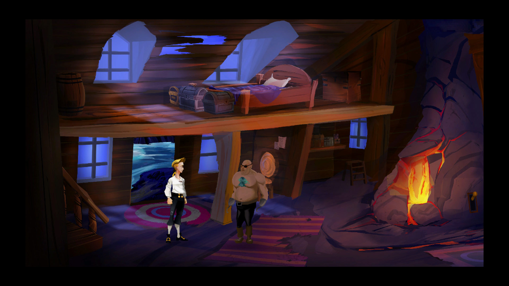
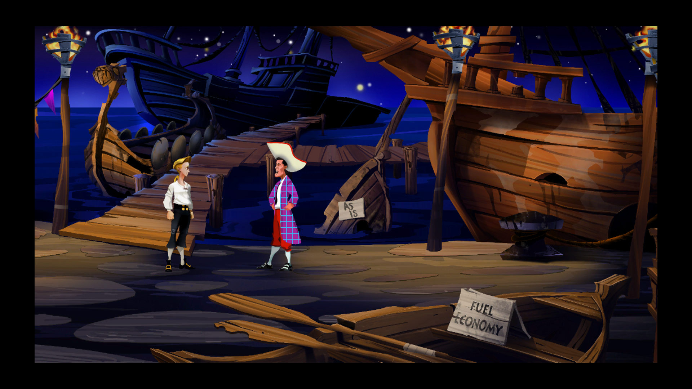
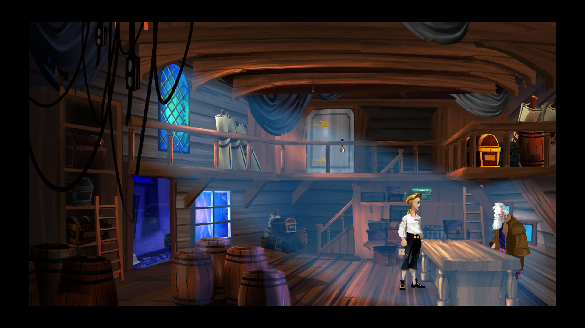

# The Secret of Monkey Island: Special Edition · visual reference

<!-- reference-navigation:start -->
[← Previous: The Secret of Monkey Island: Special Edition](README.md) · [🖼️ Library](../../README.md) · **34 / 36** · [Next: Infinity Blade →](../infinity-blade/README.md)
<!-- reference-navigation:end -->

**Look for:** Funny actions and surprising consequences, economical scene reuse.

[Game study](README.md) · Research 22 October 2026; official stills inspected, not a complete play session.

## Frame 1

Credit: LucasArts and respective rightsholders. [Source page](https://store.steampowered.com/app/32360/) · [Original image](https://shared.akamai.steamstatic.com/store_item_assets/steam/apps/32360/ss_ce07cc2b68cc3c8b02c8222d078afa975c084a39.1920x1080.jpg?t=1741729431)

SHA-256: `e9764ca8413bdbf387bf910668fc0f6178393539a0a9d4716623eaeccda3d186`. Research only; no runtime reuse license.

## Frame 2

Credit: LucasArts and respective rightsholders. [Source page](https://store.steampowered.com/app/32360/) · [Original image](https://shared.akamai.steamstatic.com/store_item_assets/steam/apps/32360/ss_1b7837925734f3240cc4570f465d3a31749eabe8.1920x1080.jpg?t=1741729431)

SHA-256: `d861e3195424fe418f3cb466d602e84946bbe59207f55feb2f6aab50efd10801`. Research only; no runtime reuse license.

## Frame 3

Credit: LucasArts and respective rightsholders. [Source page](https://store.steampowered.com/app/32360/) · [Original image](https://shared.akamai.steamstatic.com/store_item_assets/steam/apps/32360/ss_ef1df454ee0b4b9386d2ae538b83f2c8cba60fe0.1920x1080.jpg?t=1741729431)

SHA-256: `2699a441616f84f0be1650eb6991b0bfe1ea05548464776299ce1dfadb681f63`. Research only; no runtime reuse license.

## Gameplay study

Use official trailers on the source page to compare scale, feedback and camera behavior. Keep observation separate from developer-pipeline claims.

<!-- reference-navigation:start -->
[← Previous: The Secret of Monkey Island: Special Edition](README.md) · [🖼️ Library](../../README.md) · **34 / 36** · [Next: Infinity Blade →](../infinity-blade/README.md)
<!-- reference-navigation:end -->
