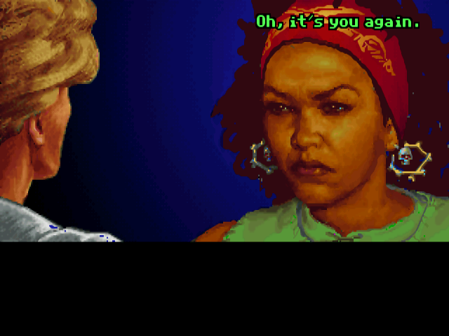
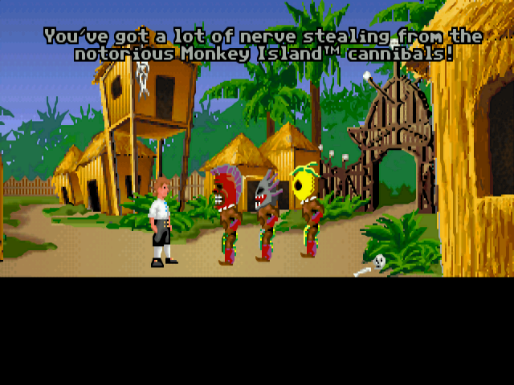
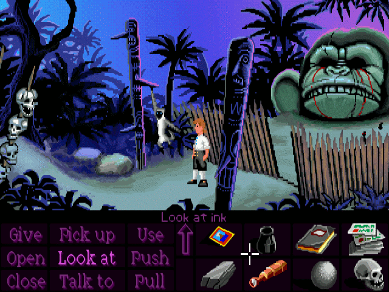
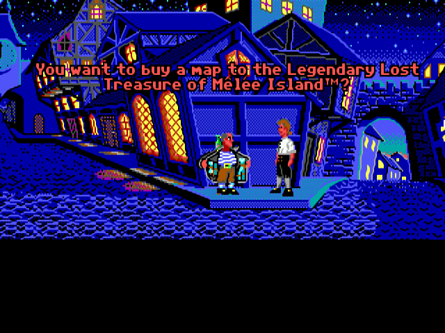
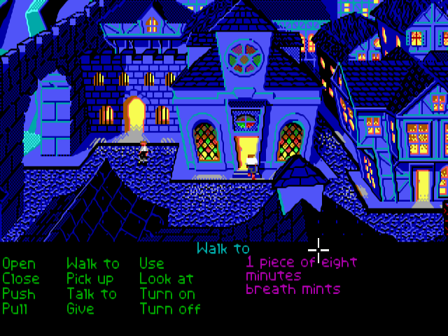
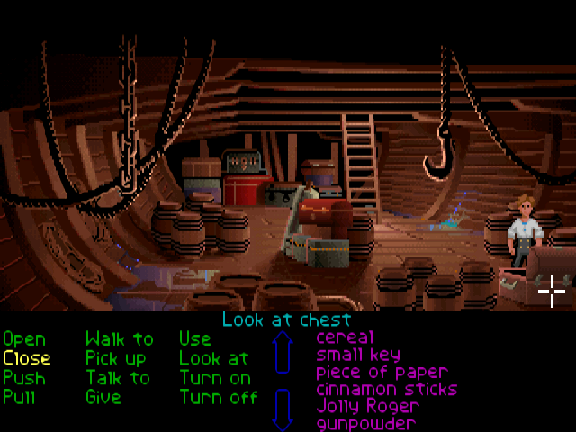

# The Secret of Monkey Island · classic · visual reference

<!-- nav:start -->
[← The Secret of Monkey Island · classic pixel art](README.md) · [Game references](../../README.md) · **34 / 36** · [Infinity Blade · technology remembered as myth →](../infinity-blade/README.md)
<!-- nav:end -->

**Classic pixel art only.** CD/DOS, EGA and VGA captures are labeled below; Special Edition repaint screenshots have been removed.

[Game study](README.md) · [Hashes and full provenance](media-sources.json)

Selected visual research, 22 October 2026. These are existing-game references, not our concept art or runtime assets. Video frames are captured at the listed source times without browser/player overlays. A still cannot establish responsiveness or the exact timing of an attack.

## Classic CD/DOS view

Classic CD/DOS view: the curved bridge and irregular rock face read as continuous shapes, despite the pixel grid.

Credit: Lucasfilm Games / LucasArts; capture hosted by ScummVM. [Source](https://www.scummvm.org/en/screenshots/lucasarts/mi/).

## Classic CD/DOS close-up

Classic CD/DOS close-up: broad color clusters and a curved face create expression without block-like construction.

Credit: Lucasfilm Games / LucasArts; capture hosted by ScummVM. [Source](https://www.scummvm.org/en/screenshots/lucasarts/mi/).

## Classic CD/DOS village

Classic CD/DOS village: irregular huts, timber and vegetation form a coherent low-resolution environment.

Credit: Lucasfilm Games / LucasArts; capture hosted by ScummVM. [Source](https://www.scummvm.org/en/screenshots/lucasarts/mi/).

## Classic CD/DOS village detail

Classic CD/DOS village detail: curved supports and large color masses separate foreground structure from backdrop.

Credit: Lucasfilm Games / LucasArts; capture hosted by ScummVM. [Source](https://www.scummvm.org/en/screenshots/lucasarts/mi/).

## Classic EGA street view

Classic EGA street view: uneven rooflines and selective bright windows give a small palette a clear hierarchy.

Credit: Lucasfilm Games / LucasArts; capture hosted by ScummVM. [Source](https://www.scummvm.org/en/screenshots/lucasarts/mi/).

## Classic EGA street and verb interface

Classic EGA street and verb interface: inspect the crooked buildings rather than borrowing the large command UI.

Credit: Lucasfilm Games / LucasArts; capture hosted by ScummVM. [Source](https://www.scummvm.org/en/screenshots/lucasarts/mi/).

## Classic VGA ship interior

Classic VGA ship interior: curved hull, sloping beams and layered staging; an environment need not follow square tiles.

Credit: Lucasfilm Games / LucasArts; capture hosted by ScummVM. [Source](https://www.scummvm.org/en/screenshots/lucasarts/mi/).

## Gameplay study

[Primary gallery and platform/variant labels](https://www.scummvm.org/en/screenshots/lucasarts/mi/). These stills support a contour, color-cluster and staging study. They do not prove collision geometry or that WinCS should use an adventure-game camera or interface.

<!-- nav:start -->
[← The Secret of Monkey Island · classic pixel art](README.md) · [Game references](../../README.md) · **34 / 36** · [Infinity Blade · technology remembered as myth →](../infinity-blade/README.md)
<!-- nav:end -->
