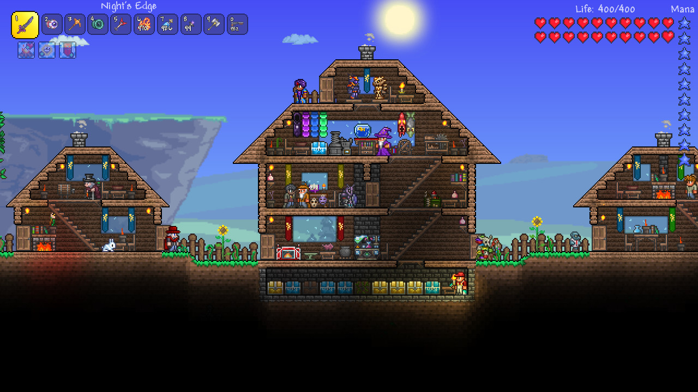

# Terraria

<!-- reference-navigation:start -->
[← Previous: Dead Cells · gallery](../dead-cells/visual-reference.md) · [🖼️ Library](../../README.md) · **27 / 36** · [Next: Terraria · gallery →](visual-reference.md)
<!-- reference-navigation:end -->

**Look for:** Side-view terrain and oversized encounter silhouettes; optional replay-boss comparison.

[Gallery and credits](visual-reference.md) · [Voice-note context](../../../docs/brief/voice-notes.md)

Research: 22 October 2026. Newly named audio reference; not a replacement for Vatsal's creative authority.

## Mechanics and dependencies

Digging, fighting, exploration and building are presented together by Re-Logic. For WinCS, use only a readable side-view terrain/encounter study: the sandbox, crafting, destructibility and progression economy are separate expensive systems.

## Worldbuilding and visual observation

Worldbuilding can emerge from terrain, dwellings and contrasting underground layers. The inspected frames show a settlement, a lava encounter and a dark cavern. Borrow readable ground edges and telegraphs, not tile sets, boss anatomy or maps.

## Proposed WinCS experiment

A tall first-run original encounter could occupy a fixed readable arena. Professor/Moon Lord and yogurt/Wall of Flesh comparisons remain optional replay jokes, not a request to reproduce those bosses.

## Source and production boundary

[Developer/publisher store page](https://store.steampowered.com/app/105600/). Credit: Re-Logic and respective publisher/rightsholders. Three official store stills were visually inspected; frame timing and full gameplay were not tested. Engine, sprite organization and internal tools are not established by this check. For our own production, use the [layer workflow](../../../docs/design/layered-stage-workflow.md); the source game's production files are not available or licensed through these screenshots.

<!-- reference-navigation:start -->
[← Previous: Dead Cells · gallery](../dead-cells/visual-reference.md) · [🖼️ Library](../../README.md) · **27 / 36** · [Next: Terraria · gallery →](visual-reference.md)
<!-- reference-navigation:end -->
