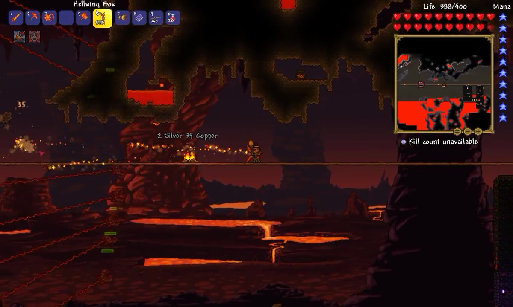
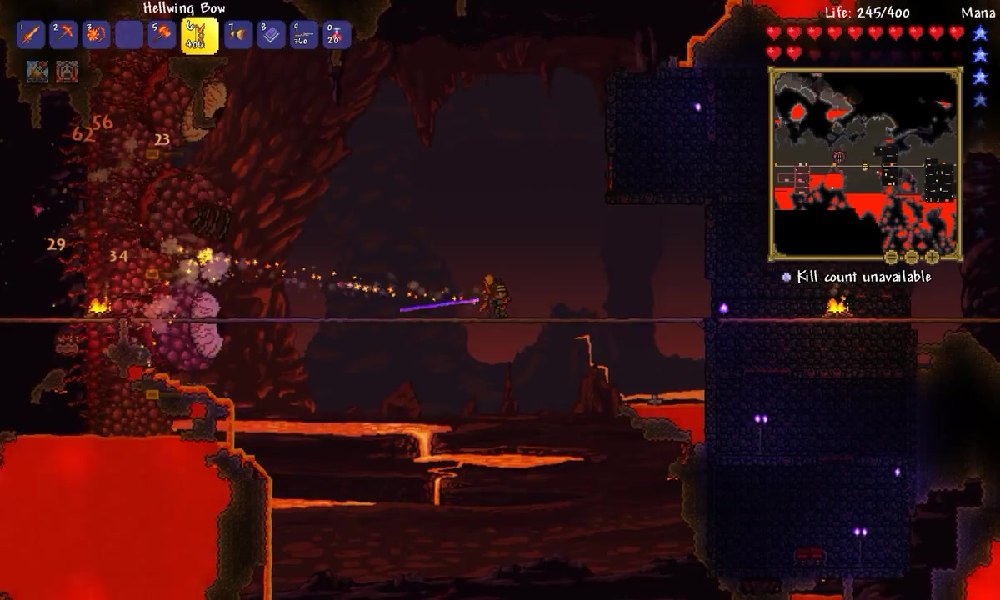
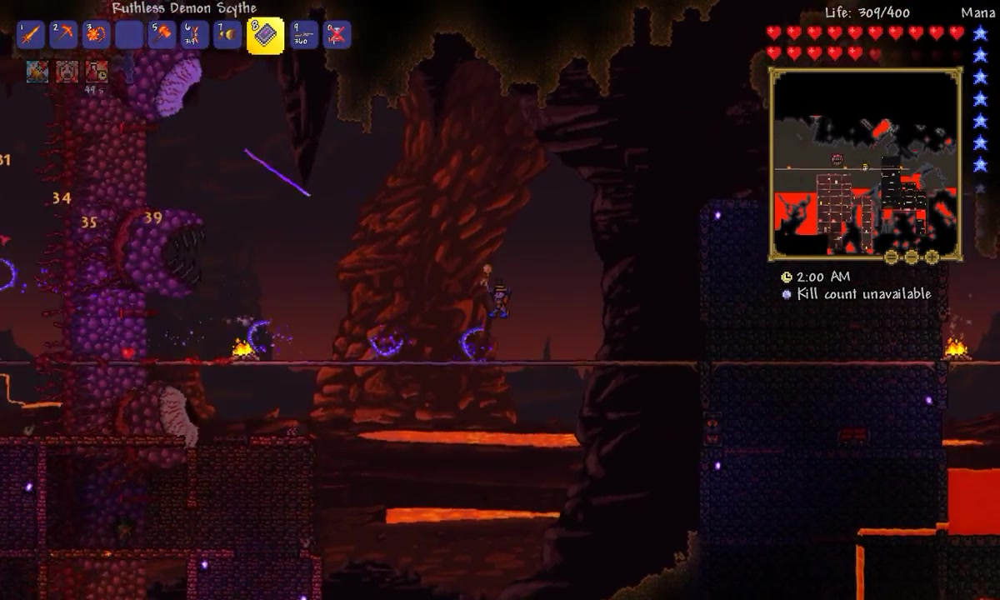
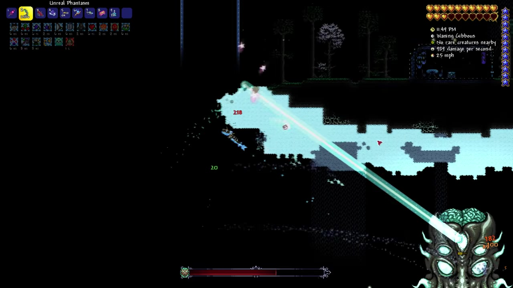
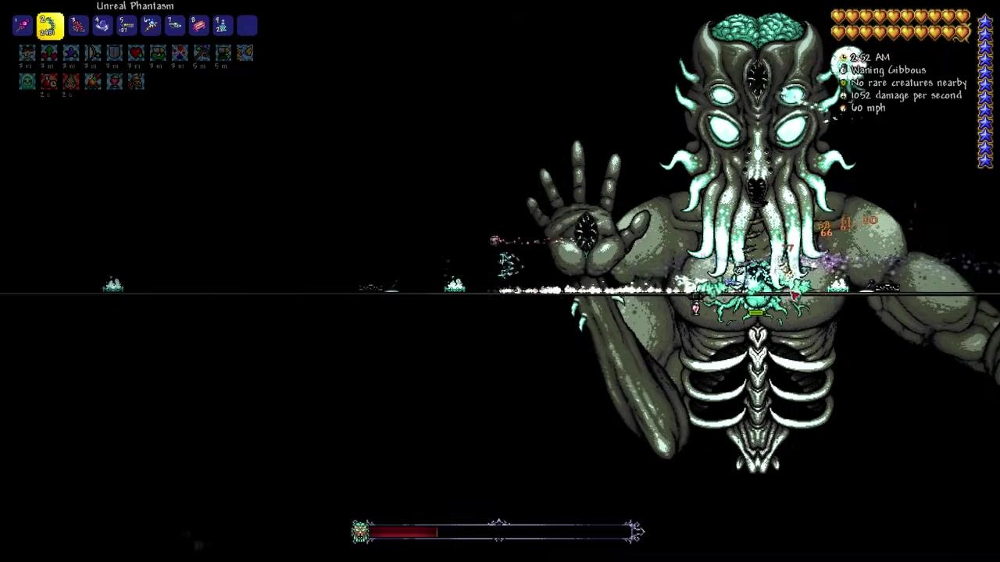
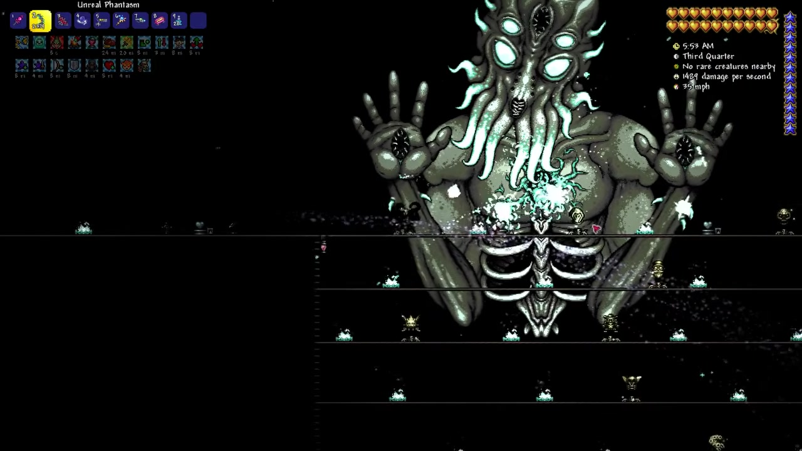

# Terraria · visual reference

<!-- reference-navigation:start -->
[← Previous: Terraria](README.md) · [Game index](../../README.md) · **28 / 36** · [Next: Little Nightmares →](../little-nightmares/README.md)

[📍 Campus boards](../../campus/README.md) · [🎮 Game studies](../../README.md) · [🎨 Stage experiments](../../production/README.md) · [Proposal](../../../docs/proposal/campus-game.md)
<!-- reference-navigation:end -->

**Boss shapes and encounter ideas only:** Wall of Flesh and Moon Lord. The platforms in these captures are incidental, not a terrain reference.

[Game study](README.md) · [Hashes and full provenance](media-sources.json)

Selected visual research, 22 October 2026. These are existing-game references, not our concept art or runtime assets. Video frames are captured at the listed source times without browser/player overlays. A still cannot establish responsiveness or the exact timing of an attack.

## 1:53 · Wall of Flesh enters as a tall, advancing body with several attack points.

Wall of Flesh enters as a tall, advancing body with several attack points.

Credit: Re-Logic; gameplay recording JoeDuh / Joseph Afflitto. [Source at 1:53](https://www.youtube.com/watch?v=aXkgcce3zLA&t=113s).

## 3:08 · Large eyes and mouth remain separate focal targets along a moving wall.

Large eyes and mouth remain separate focal targets along a moving wall.

Credit: Re-Logic; gameplay recording JoeDuh / Joseph Afflitto. [Source at 3:08](https://www.youtube.com/watch?v=aXkgcce3zLA&t=188s).

## 3:45 · The pursuer dominates one screen edge

The pursuer dominates one screen edge; the encounter keeps pushing the player.

Credit: Re-Logic; gameplay recording JoeDuh / Joseph Afflitto. [Source at 3:45](https://www.youtube.com/watch?v=aXkgcce3zLA&t=225s).

## 1:37 · Moon Lord

Moon Lord: head, hands and torso form a large multipart silhouette.

Credit: Re-Logic; gameplay recording FFM TV. [Source at 1:37](https://www.youtube.com/watch?v=rgkkUPYymzw&t=97s).

## 3:14 · A bright directional beam cuts across the encounter

A bright directional beam cuts across the encounter; compare the tell with the body pose.

Credit: Re-Logic; gameplay recording FFM TV. [Source at 3:14](https://www.youtube.com/watch?v=rgkkUPYymzw&t=194s).

## 6:28 · Separated hand/eye targets and body make several simultaneous points of attention.

Separated hand/eye targets and body make several simultaneous points of attention.

Credit: Re-Logic; gameplay recording FFM TV. [Source at 6:28](https://www.youtube.com/watch?v=rgkkUPYymzw&t=388s).

## 9:42 · The exposed central body contrasts with the outstretched hands

The exposed central body contrasts with the outstretched hands; study the boss, not the platforms.

Credit: Re-Logic; gameplay recording FFM TV. [Source at 9:42](https://www.youtube.com/watch?v=rgkkUPYymzw&t=582s).

## Gameplay study

Watch the Wall of Flesh sequence around 1:53–3:45 and the Moon Lord sequence around 1:37–3:14 in the linked recordings. Compare approach pressure and multipart attack attention, not the background geometry. Optional jam boss work replaces another system; it is not added to the lake prototype by default.

<!-- reference-navigation:start -->
[← Previous: Terraria](README.md) · [Game index](../../README.md) · **28 / 36** · [Next: Little Nightmares →](../little-nightmares/README.md)

[📍 Campus boards](../../campus/README.md) · [🎮 Game studies](../../README.md) · [🎨 Stage experiments](../../production/README.md) · [Proposal](../../../docs/proposal/campus-game.md)
<!-- reference-navigation:end -->
