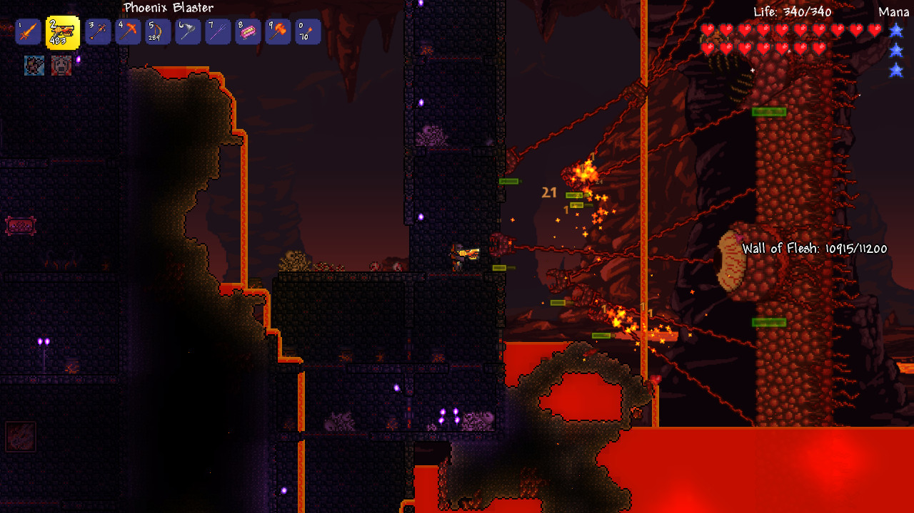
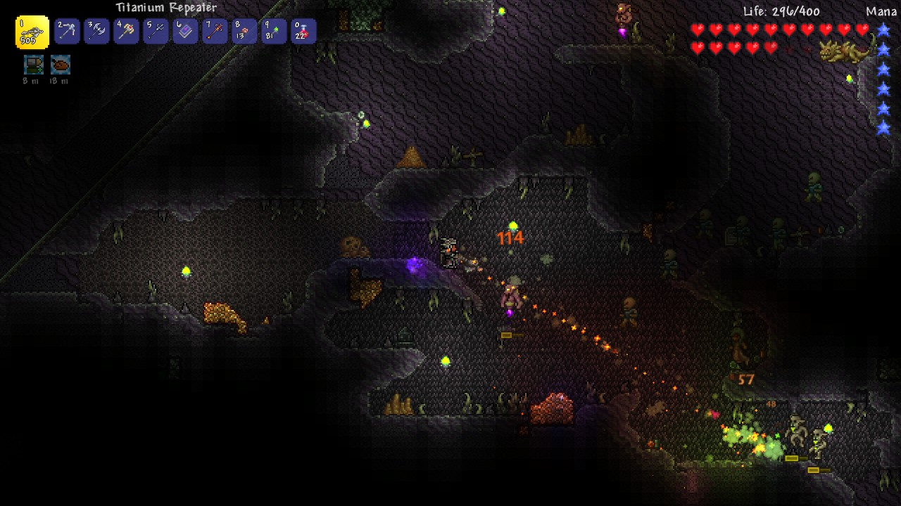

# Terraria · visual reference

<!-- reference-navigation:start -->
[← Previous: Terraria](README.md) · [🖼️ Library](../../README.md) · **28 / 36** · [Next: Little Nightmares →](../little-nightmares/README.md)
<!-- reference-navigation:end -->

**Look for:** Side-view terrain and oversized encounter silhouettes; optional replay-boss comparison.

[Game study](README.md) · Research 22 October 2026; official stills inspected, not a complete play session.

## Frame 1

Credit: Re-Logic and respective rightsholders. [Source page](https://store.steampowered.com/app/105600/) · [Original image](https://shared.akamai.steamstatic.com/store_item_assets/steam/apps/105600/ss_8c03886f214d2108cafca13845533eaa3d87d83f.1920x1080.jpg?t=1792530636)

SHA-256: `2d87f640da5802848f7b4d2fb6eafe5b8b40fbe165e26dcf38b4d70618e032cb`. Research only; no runtime reuse license.

## Frame 2

Credit: Re-Logic and respective rightsholders. [Source page](https://store.steampowered.com/app/105600/) · [Original image](https://shared.akamai.steamstatic.com/store_item_assets/steam/apps/105600/ss_ae168a00ab08104ba266dc30232654d4b3c919e5.1920x1080.jpg?t=1792530636)

SHA-256: `60d2c6e96e95975f2976ab87c93624eb77657e8a88f873fb89939ac26aab9cb5`. Research only; no runtime reuse license.

## Frame 3

Credit: Re-Logic and respective rightsholders. [Source page](https://store.steampowered.com/app/105600/) · [Original image](https://shared.akamai.steamstatic.com/store_item_assets/steam/apps/105600/ss_9edd98caaf9357c2f40758f354475a56e356e8b0.1920x1080.jpg?t=1792530636)

SHA-256: `3b55ff9aa76f1ccce2f6acf73a2fd38523e90b8af81c9f933a6f20a5eed3bd40`. Research only; no runtime reuse license.

## Gameplay study

Use official trailers on the source page to compare scale, feedback and camera behavior. Keep observation separate from developer-pipeline claims.

<!-- reference-navigation:start -->
[← Previous: Terraria](README.md) · [🖼️ Library](../../README.md) · **28 / 36** · [Next: Little Nightmares →](../little-nightmares/README.md)
<!-- reference-navigation:end -->
