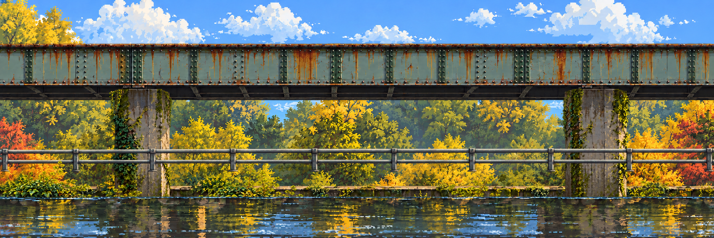
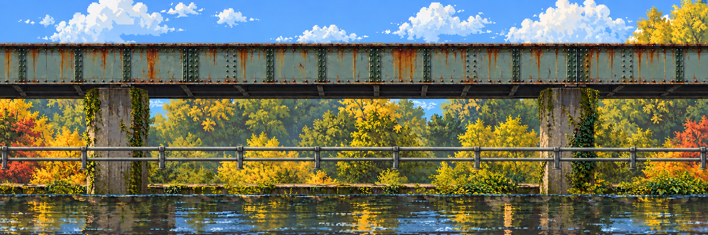

# Rusty Crossings · one creek, a route worth finding

**[Open the location viewer](viewer.html)** · [Photo board](../../campus/crossings.md#location-photo-board) · [Stage library](../README.md) · [Pipeline](../../../docs/technical/stage-art-pipeline.md)


**Replacement, 23 October.** This location replaces the former full-scene mutation and its drifting center extractions. Five roles stay fixed: sky/trees, bank, water, near rails and plants. Only architecture changes. Broad bridges, ladders, return paths and side branches retain the earlier maze's character. Algorithms and data structures influence the route, rather than erasing the campus setting.

## See the journey

| Entry / first climb | Branches / reconnection | Boss clearing / exit |
| --- | --- | --- |
|  |  |  |

| Clean left | Clean center | Clean right |
| --- | --- | --- |
|  |  |  |

The [photo collage](../../campus/images/crossings.png) supplies riveted blue-green steel, rust, mossy piers, tubular grey rails, autumn growth and creek water. The stage is newly arranged in flat side elevation. Shared nature panels mirror on alternating chunks; this preserves identical boundary samples, not a surveyed campus layout.

The [route contract](route.json) reserves an entry, climbing routes, returnable dead ends, a reconnection, an open boss clearing and an exit. Viewer annotations show walk, ladder, proposed jump and exploration edges at an **18×32** body scale. Its graph is connected, including boss and exit; jump edges fit the proposed 180-pixel horizontal / 120-pixel rise envelope. This is **authoring intent, not a physics playtest**. Spurs have explicit intermediate walk/climb anchors; all platforms still need clearance/collision review. No boss or game is implemented.

## Seven registered roles · every chunk

| Role | Left | Center | Right | Use |
| --- | --- | --- | --- | --- |
| Sky / distant trees | [PNG](images/01-distance-left.png) | [PNG](images/01-distance-center.png) | [PNG](images/01-distance-right.png) | Fixed identity; future slow parallax |
| Rear masonry cuts | [PNG](images/02-supports-left.png) | [PNG](images/02-supports-center.png) | [PNG](images/02-supports-right.png) | Disjoint regions of the repaired structure |
| Rocky bank | [PNG](images/03-bank-left.png) | [PNG](images/03-bank-center.png) | [PNG](images/03-bank-right.png) | Fixed shoreline; not collision inferred from pixels |
| Water / reflection mask | [PNG](images/04-water-left.png) | [PNG](images/04-water-center.png) | [PNG](images/04-water-right.png) | Current-scene reflection clipping |
| Broad girders / ladders | [PNG](images/05-traversal-left.png) | [PNG](images/05-traversal-center.png) | [PNG](images/05-traversal-right.png) | Visible traversal architecture; explicit future bodies |
| Decorative near rails | [PNG](images/06-near-rails-left.png) | [PNG](images/06-near-rails-center.png) | [PNG](images/06-near-rails-right.png) | Foreground occlusion; never a collider by default |
| Near foliage | [PNG](images/07-foliage-left.png) | [PNG](images/07-foliage-center.png) | [PNG](images/07-foliage-right.png) | Separate alpha; boss-floor readability window |

Clean-state architecture: [left](images/clean-architecture-left.png), [center](images/clean-architecture-center.png), [right](images/clean-architecture-right.png). Clean traversal role is empty; its future walking surface needs explicit geometry. All other clean-state roles reuse the exact same image files as the maze.

Every plate is **2160×720**, three chunks span **6480×720**, and six roles have real alpha. No center-only approximation or independently regenerated cutout is used. Masonry and traversal are disjoint source-region masks, so they reconstruct the same repaired structure exactly. They are static cuts, not individually reconstructed columns or freely movable ladders. Do not animate their relative positions without filling hidden material and extracting per-object bodies.

## Exact order

1. Inspect the collage and preferred earlier maze. Design quiet entry, climbs, branches, recovery, clearing and exit before extracting anything.
2. Generate three **transparent scene-first architecture plates**, without water/sky/foliage. Preserve the nature plates separately. Prompts request compatible low edge decks and readable empty chambers.
3. Explicitly normalize native generation sizes with nearest-neighbor sampling. Preserve native sources. Remove the saturated red debug matte using the documented predicate, retaining brown/orange rust.
4. Prepare two brick-offset join contexts with `stage_art.py`. Generate repairs, then copy only each central 512-pixel band, including alpha. World copy bands are `[1904,2416)` and `[4064,4576)`. Inspect both band edges, not only the join center.
5. Apply a separately reported post-repair matte cleanup. Split the repaired structure using the authored regions in [assembly.json](assembly.json). Never redraw the seven layers independently.
6. Assemble all seven roles in the same space. Existing distant trees, bank, water, near rails and clean architecture come from the earlier study; new foliage is independently generated as a compositional strip. Its scale/offset and boss-floor alpha window are explicit.
7. Export every chunk/role, clean architecture and six masters. Verify hashes, alpha, dimensions and exact master recomposition. Inspect isolation on light/dark, routes at body scale, every seam and both states. Only then extract movable objects, fill occlusions, animate or build colliders.

The viewer keeps the same location URL and replaces its old candidate images. It includes photo comparison, three-banner panning, whole-journey overview, visible seams/repair edges, state wipe, 404 reveal, route overlay, all-layer isolation, chunk gallery and master/recomposition proof. Optional water reflection samples the **currently visible scene** through the water alpha. The base texture still includes older painted color; this is a reflection preview, not final water rendering. Reduced-motion preference skips the animated reveal.

## Sources and reproducibility

Native built-in image generation outputs and two repair candidates are in [sources/](sources/). Exact six prompts: [prompts.json](prompts.json). Source and export hashes/native dimensions/alpha: [media-sources.json](media-sources.json). Mask regions, offsets and draw order: [assembly.json](assembly.json). Prepared seam snapshot: [packet.json](packet.json), [stage.json](stage.json), [repair-report.json](repair-report.json). Combined verification: [verification.json](verification.json).

```powershell
python scripts/creek_layers.py
python -m unittest discover -s scripts -p 'test_*.py' -v
python scripts/check_docs.py
```

To reproduce the selected derived exports in place: `python scripts/creek_layers.py --build`. This is an explicit rebuild, with no network call. Use a fresh packet directory for another art iteration:

```powershell
python scripts/stage_art.py prepare --config references/production/campus-mutation/stage.json --out tmp/stage-art/creek-next --band 512
```

Generate each prepared context with its edit mask, save candidates by job ID, then use `stage_art.py apply` as described in the [pipeline](../../../docs/technical/stage-art-pipeline.md). Do not reuse the recorded packet after changing sources/configuration. The model field in the adapter config selects the API route; it is not a claim that the built-in tool disclosed its model.

## Extend without losing registration

Left/right or middle: add a stable chunk ID, all seven role plates, clean architecture and route boundary ports. Recompute origins, prepare affected neighboring contexts, repair the composed structure, then derive masks again. Existing approved source art stays fixed. Check traversal ports and reflection coverage at both new seams.

Up/down: design a shared two-dimensional chunk grid, vertical edge ports and vertical overlap windows first. The current compositor implements one horizontal row; vertical expansion is **specified future work**, not an existing flag. Never stretch this strip vertically or promise automatic infinite expansion.

**Remaining gates:** team approval of the art/scale, detailed headroom/collider tracing, physically reachable jumps and ladder transitions, per-object fill/rigs, final reflection treatment and theme/pre-work rules. Graph and pixel checks do not decide those gates. Earlier independent studies stay in the library as history; this replaces only the rejected combined location.
