# Rusty Crossings · the creek becomes the maze

**[Open the combined viewer](viewer.html)** · [Original photo board](../../campus/crossings.md#location-photo-board) · [Stage library](../README.md) · [Reusable process](../../../docs/technical/stage-art-pipeline.md)

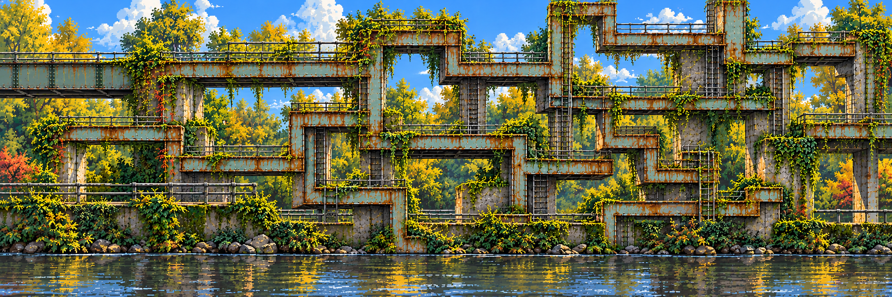

**23 October · current combined visual candidate.** The pale blue-green rivets, rust, mossy concrete, tubular grey rails, autumn growth and creek come from the approved photographic collage. The broad branching girders and tall shafts come from the preferred maze study. They now inhabit one newly designed flat side-scrolling scene. This replaces the earlier separation into unrelated location and maze views.

## Place first, then let it misbehave

| Photographic identity | Clean side elevation | Mutated center |
| --- | --- | --- |
|  |  |  |

The collage is a material/landmark reference, not a camera to copy or a measured map. The viewer compares all three and previews a short row-cut/stretch transition from clean to mutated. It is a presentation prototype, not a physics event or a finished level. It honors reduced-motion preference with an immediate swap.

## Three banners, two repaired joins

| Left | Center | Right |
| --- | --- | --- |
| 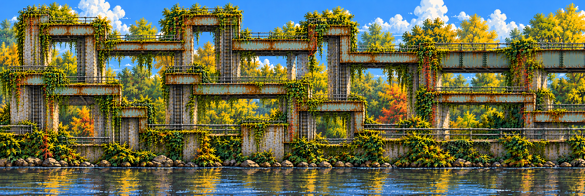 |  | 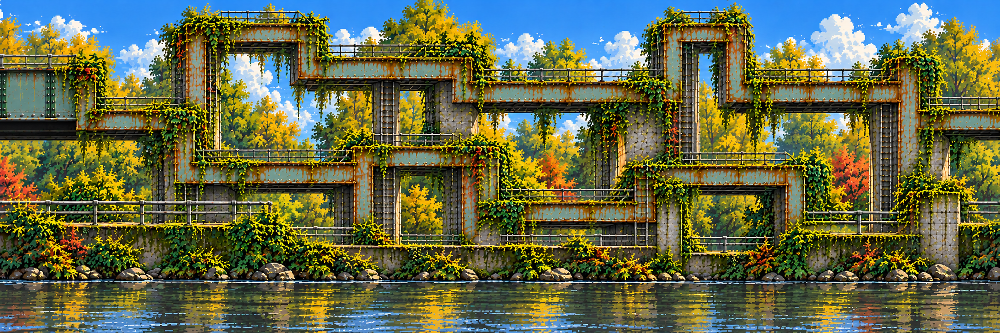 |

Three chunks span **6480×720**, using canonical **2160×720** review panels. Native generated images are preserved; explicit nearest-neighbor sampling is recorded in [provenance](media-sources.json). The source paintings vary slightly in size and geometry. Do not call their butt joins seamless.

| Left–center repair context | Center–right repair context |
| --- | --- |
| 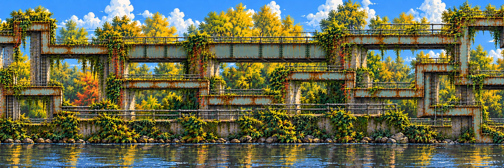 | 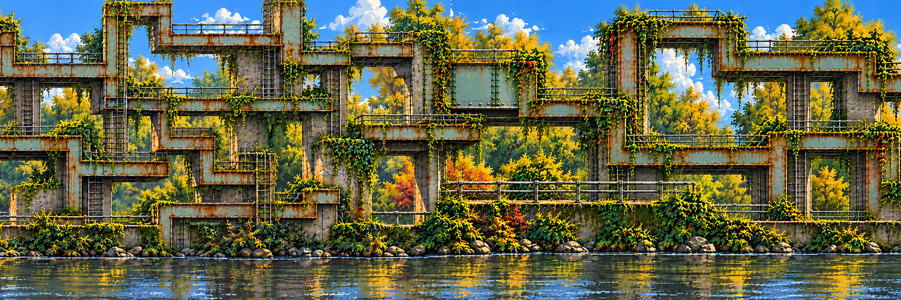 |

The [stage configuration](stage.json) prepares staggered full-width contexts centered at each join. Only their central **512×720** bands replace the source world: `[1904,2416)` and `[4064,4576)`. The other pixels are protected, including alpha. The [offline verification](verification.json) records **zero changed pixels outside those bands**. This invariant does not certify artistic continuity: inspect both patch edges, waterline, rails and platform endpoints in the viewer. The complete generated repair window is never laid over the world.

The clean-state comparison reuses the earlier location panels and bounded repair candidates from the [seam study](../seam-pipeline/README.md). The new mutation has its own source paintings, repair packet and report.

## Seven center roles, visibly inspectable

1. **Distant sky and trees:** a filled background behind removed structures.
   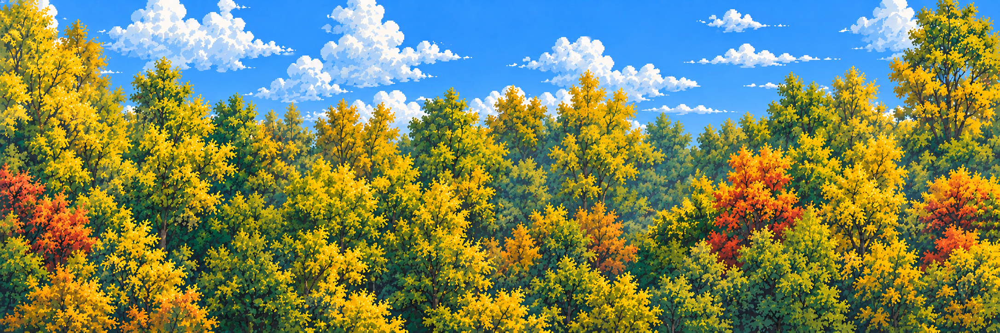
2. **Rear concrete / shafts:** background support structure.
   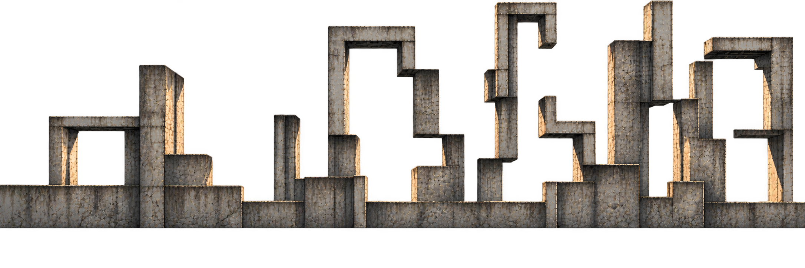
3. **Creek bank:** rocks, moss and ground edge.
   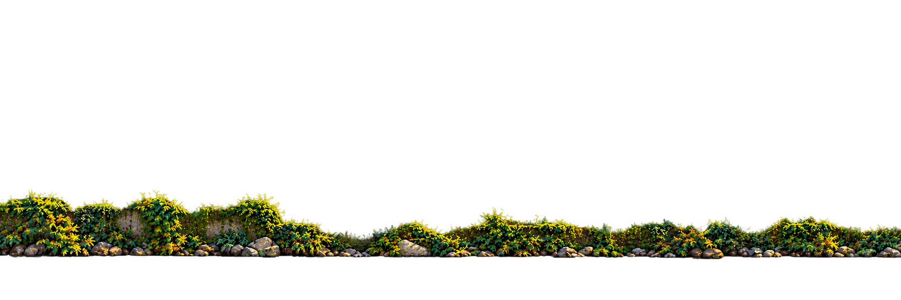
4. **Water:** separate surface/reflection boundary.
   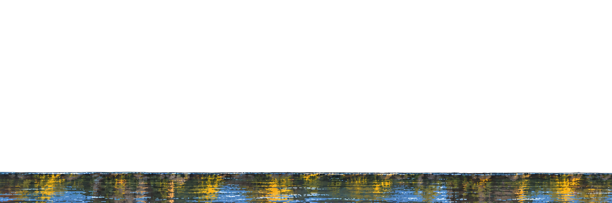
5. **Traversal:** broad girders, platforms and ladders.
   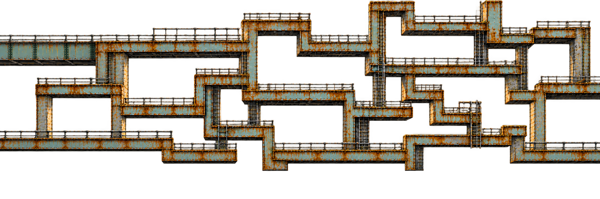
6. **Near rails:** decorative occluders, distinct from traversal.
   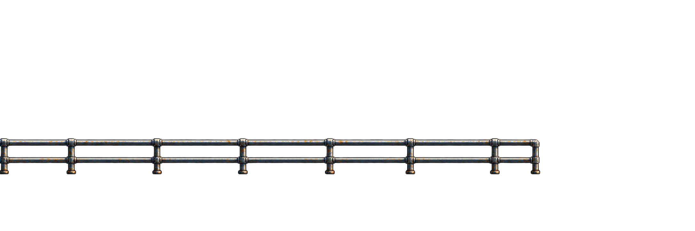
7. **Foliage:** ivy and near growth for later localized movement.
   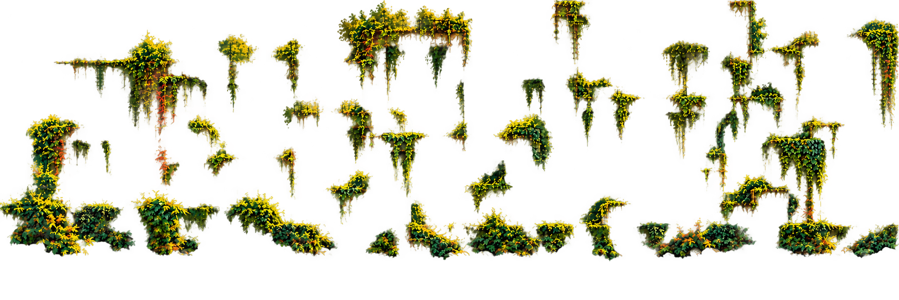

Six plates have genuine alpha; the distance plate is opaque. Use the viewer's individual isolates, toggles, checkerboard and master/recomposition wipe. **These are extraction trials, not a passed mask pack:** supports and traversal overlap; near rails do not reproduce the master's exact span; foliage still contains colored fringe and residual surface texture despite a second extraction. Bank and foliage duplicate some growth. No wing decomposition, per-object rigs or collision bodies are claimed. The full painted master is the reliable visual reference while decomposition is reviewed.

The water master currently contains painted reflections. Runtime reflections should instead sample the current approved scene/actors, mirror them through a chunk-local water mask and update after mutation. The water extraction provides a reference boundary; it is not that shader or a dynamic reflection implementation.

## Repeat or expand the process

```powershell
python scripts/stage_art.py prepare --config references/production/campus-mutation/stage.json --out tmp/stage-art/campus-mutation-v2 --band 512
# Put selected full-context candidates in the packet's candidates directory,
# named mutation--left--center.png and mutation--center--right.png.
python scripts/stage_art.py apply --packet tmp/stage-art/campus-mutation-v2 --candidates tmp/stage-art/campus-mutation-v2/candidates --out tmp/stage-art/campus-mutation-v2/applied --normalize
```

Run from the repository root. The committed packet snapshot and report document v1. Preparation is immutable; use a new output directory. The [exact pipeline](../../../docs/technical/stage-art-pipeline.md) covers generation, masks, API dry run and shared chunk insertion. Each future depth role supplies every ordered chunk before its own join jobs can be prepared. Authoring only center plates does not satisfy that three-chunk layer contract.

Approve this recognizable composition, its joins and its player scale first; fix extraction registration and alpha next; extend approved depth plates to the wings; then extrapolate individual objects and author a tested collision route. This order avoids manually assembling an unrelated prop kit. Full-sized exports/recompositions are reproducible scratch, outside Git.

All twelve selected images were made with **built-in image generation**, whose model ID was not exposed. No paid API request was made. [Exact prompts](prompts.json), [input/output hashes, native dimensions and source graph](media-sources.json), [protected-pixel report](verification.json). Raw photos, professor screenshots and audio remain outside Git; the approved campus collages are unchanged.

**Verification:** all ten offline pipeline tests and the repository's document/provenance/link checks pass. Browser review exercised clean-state restore, glitch reveal, left/right panning, center return, repair/band toggles, clean/mutated wipe, foliage isolation, all-layer restore, light checkerboard and master/recomposition wipe. The rendered comparison exposes rather than hides the remaining extraction differences.

**Review:** [PR #15](https://github.com/THD-AI/WinCS/pull/15) continues the existing branch above [PR #13](https://github.com/THD-AI/WinCS/pull/13); [issue #14](https://github.com/THD-AI/WinCS/issues/14) remains the single pipeline exception. The project board and general issue automation remain deferred, and the watcher remains paused.
