# Rusty Crossings · flat scene, long strip, separate layers

[📍 Campus boards](../../campus/README.md) · [Original collage](../../campus/crossings.md#location-photo-board) · [🎨 Stage experiments](../README.md) · [Proposal](../../../docs/proposal/campus-game.md)

**23 October · review candidate.** A newly designed side-scroller scene inspired by the collage's pale riveted steel, orange rust, mossy concrete, tubular rails, creek and autumn growth. The camera is now flat side elevation. The rejected perspective repaints are not part of this study. There is no corruption in these images.

**[Open the local visual viewer →](viewer.html)** to pan across all three banners, inspect the two staggered join windows, switch clean/traversal passes, and toggle all seven center-layer trials. It is a static review document, not a game. GitHub shows its HTML source; open the downloaded/local file in a browser. Everything is also displayed below in Markdown.

## 1 · Three clean banners

| Left extension | Center | Right extension |
| --- | --- | --- |
| [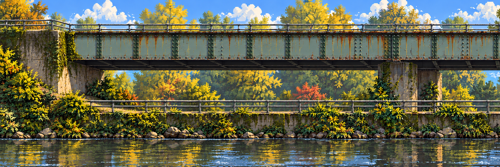](images/01-left-clean.png) |  | [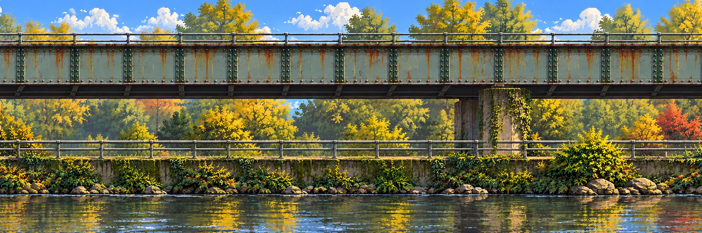](images/03-right-clean.png) |
| World `[0,W]` | World `[W,2W]` | World `[2W,3W]` |

Target W×H is **2172×724**; the three-banner review world is **6516×724**, not the camera viewport. Native generated sizes are 2170×725 for left/center and 2171×724 for right. The viewer maps each to the target review rectangle; no raster export has been normalized. Pixel-perfect continuity is **not passed**: tree/cloud details and some contours differ at the joins.

## 2 · Staggered windows across both joins

| Left–center overlap `[0.5W,1.5W]` | Center–right overlap `[1.5W,2.5W]` |
| --- | --- |
| 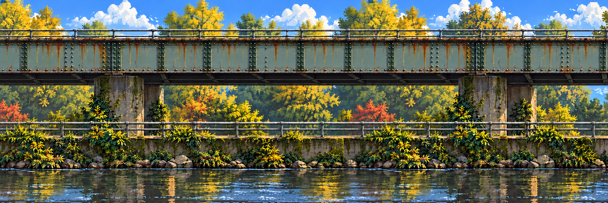 | 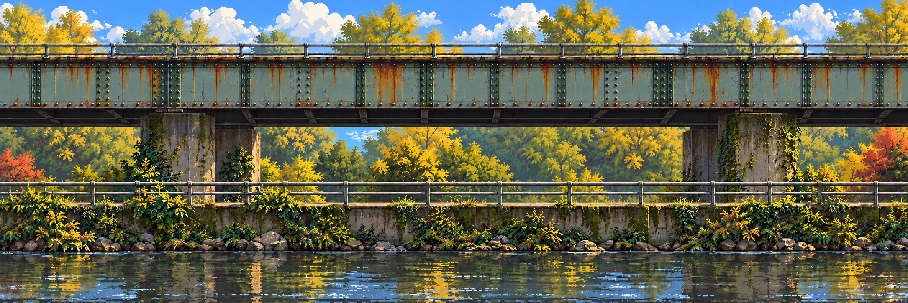 |

These are the second row of the owner's brick-laying analogy. Both are native 2170×725. They propose continuous content around the old joins, but drift from the neighbor halves and can introduce fresh outer edges. The viewer's seam overlay is **a diagnostic comparison**, not an accepted stitch. A future bounded join correction must preserve accepted outer pixels and be inspected in camera motion.

## 3 · Add traversal onto the location

| Left entry / rising branches | Center / choices | Right / exit direction |
| --- | --- | --- |
| 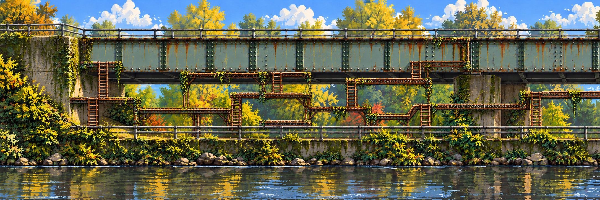 | 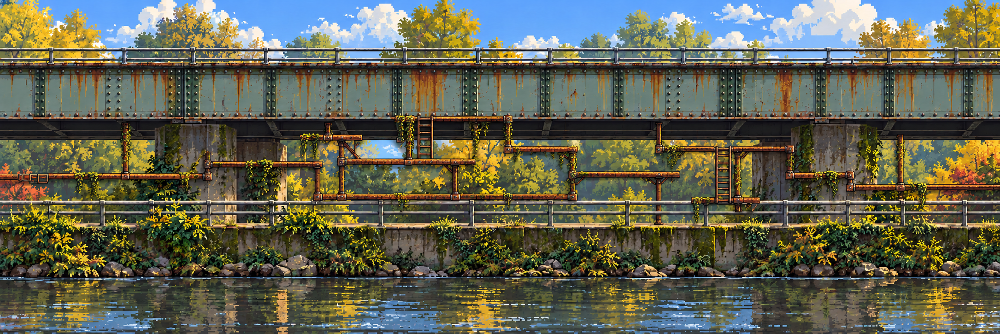 | 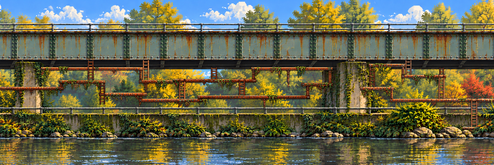 |

All three are native 2170×725. Rusted bars and ladders are generated **on the corresponding clean banner**. Existing steel/creek identity stays visible. Their routes and endpoints still need continuity, scale and controller review; this is not a solved maze or a collision map. Individual generation also changes some base pixels.

## 4 · Seven center-panel depth trials

The seven images below derive from the **center**, not the entire three-banner strip. Genuine alpha is present in plates 2–7, but edge residue, shifted features and imperfect omissions remain. The near railing is visibly displaced relative to the source. Do not promote this set to a production pack. The local viewer exposes each plate and the imperfect recomposition over a light or dark backdrop.

### 1. Far sky / trees · opaque clean-plate trial

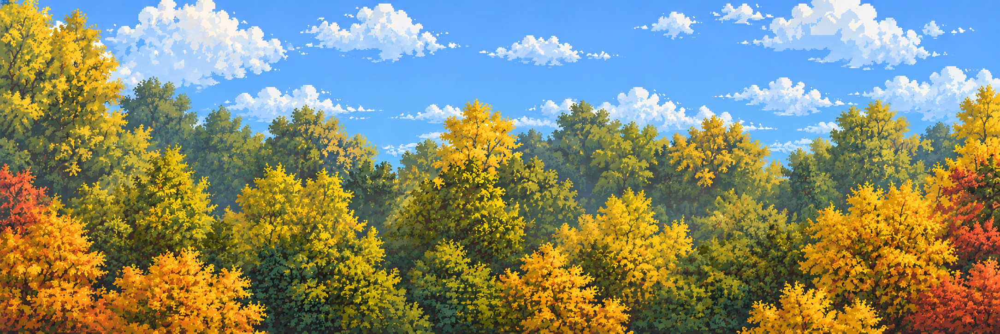

Extrapolated scenery behind the removed structures. Slow depth candidate; no collision. The newly filled tree field needs contrast review.

### 2. Bridge / concrete · rear architecture

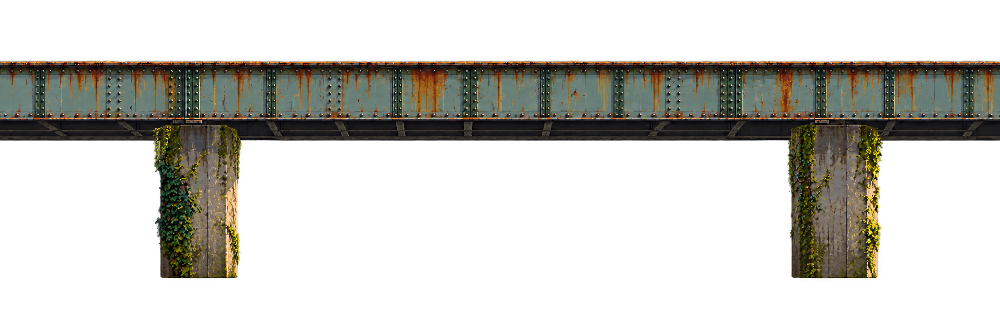

The source location's big steel span and piers. Edge residue remains; some source rail details were omitted.

### 3. Bank / ground · walking contour candidate

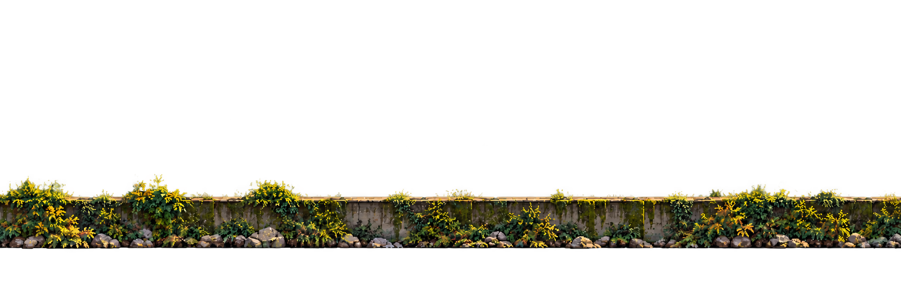

A visual ground plate. Walkable contour still needs deliberate tracing and review; texture alpha is not collision.

### 4. Creek / reflections · water region

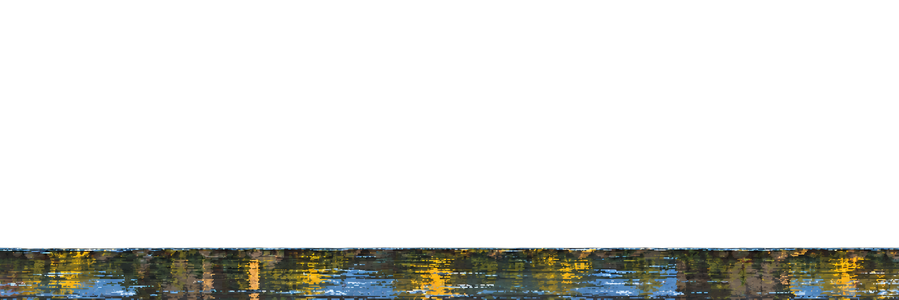

Separate water supports later localized motion. Reflection content is not a second playable world.

### 5. Orange bars / ladders · traversal network

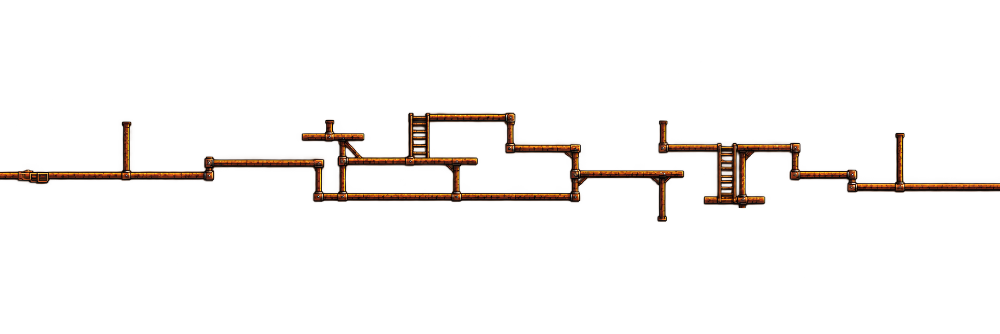

Full-canvas network retains bars and ladders together at approximate inherited locations. Occluded pieces were requested to be extrapolated. A future accepted version needs per-piece IDs, source rectangles, climb anchors and collision review; those are not completed here.

### 6. Grey safety rails · foreground occlusion

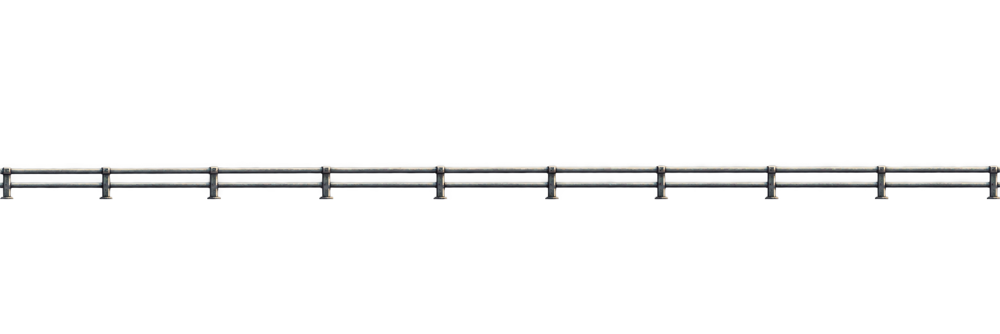

Separate from the orange traversal structure. The generated extraction shifts vertically: **alignment fails**. Displayed as a diagnostic, not silently moved to hide the failure. No automatic climb or collision role.

### 7. Plants / hanging growth · near framing

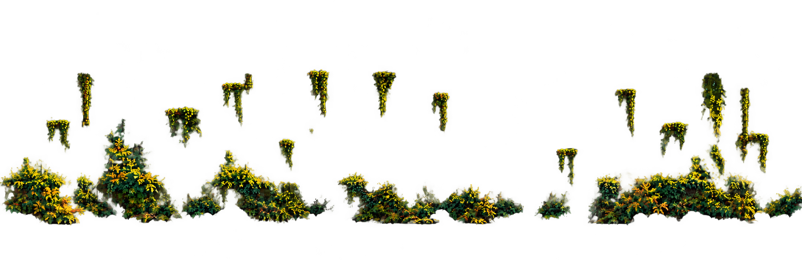

Sparse clusters could be grabbed with retained source offsets and pivots, then animated over a cleaned source. Some shapes drift and retain edge contamination. Swaying these over an unchanged master would duplicate the original plants.

## Review status and next production step

The **camera correction is implemented**; all committed panels use a side-on arrangement. Location recognition, final pixel style and design still await the owner/team. No seamless strip, clean recomposition, individual sprite catalog, rig, animation or playable route has passed. Wing-layer extraction follows approval of the center method; multiplying the current errors would create cleanup work.

The intended sequence remains: accept the clean three-banner strip and join windows → dress it → derive five-plus layers → extrapolate/grab every needed interactive or animated piece → recompose → integrate → add motion → add the villain-linked reveal/corruption. For the jam, complete one short route first and reduce stage count or optional animation if needed. [Full workflow](../../../docs/design/layered-stage-workflow.md) · [Coordinate contract](../../../docs/technical/layered-stage-contract.md).

[Exact prompts](prompts.json) · [Native sizes, hashes, alpha measurements and source graph](media-sources.json). Built-in image generation only; no model version was exposed. Original photographs remain outside Git. The earlier free-standing maze stays in the [superseded study](../master-first/README.md).

[📍 Campus boards](../../campus/README.md) · [Original collage](../../campus/crossings.md#location-photo-board) · [🎨 Stage experiments](../README.md) · [Proposal](../../../docs/proposal/campus-game.md)
