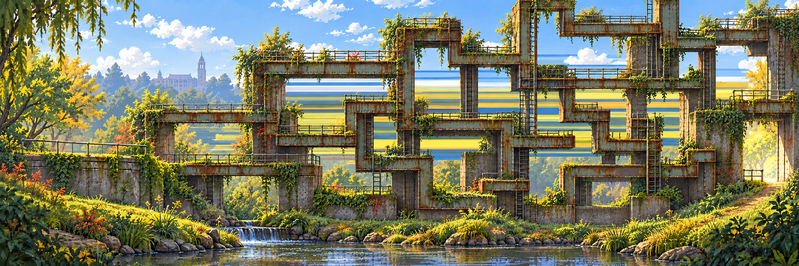
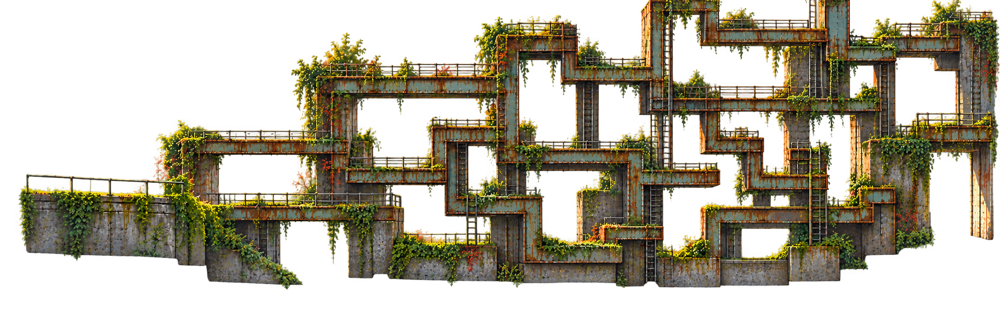

# Compose the scene first · Rusty Crossings trial

[← Current proposal](../../../docs/proposal/campus-game.md) · [Photo materials](../../campus/crossings.md) · [Production workflow →](../../../docs/design/layered-stage-workflow.md)

**23 October 2026 · visual-direction candidate, not an approved level.** One image-generation call composed the whole environment: a rusted orthogonal maze, branches and shafts, soft banks, water and a distant backdrop. It uses the campus crossings board for materials and Lost in the Green for nature motifs. It is not a conventional bridge-over-river brief, a pathfinding simulation, a verified solvable maze or final pixel art.

## Edit that composition, rather than placing a kit of separate props

The selected edit makes distant image data smear into horizontal rows through the maze openings. This is the intended **visual-only corruption** family: bad sampling, repeated strips, image cuts, stretched pixels or a later original 404-style presentation. The example keeps broadly similar foreground geometry; it does **not** prove pixel-identical preservation outside the edit. The first attempt barely showed the smear and was not selected.

The master and selected edit are both **2172×724**. A pixel-difference inspection found widespread regenerated pixels, so the edited frame is an effect reference, not a collision-safe runtime state swap. For a stable game, apply the effect to the accepted image or a scene-aligned background plate using a clipped effect region. Regeneration is for art iteration, not a guarantee of exact foreground invariance.

## Full-canvas extraction trial · not a passed layer proof

One follow-up asked for the already positioned maze on genuine alpha, keeping the whole canvas. The output is RGBA, also **2172×724**, with about **46.5% fully transparent pixels**. Broad layout is recognizable. Colored edge residue and partial-alpha/background residue remain; nonzero-alpha bounds cover the whole canvas. It is **not approved as a drop-in foreground plate**. No clean background plate or recomposition test has been completed.

This trial supports a practical production order, not a promise that automatic extraction is finished:

1. Approve a whole composition and a route that works at player scale.
2. Edit/add to that same master, protecting the accepted contour and camera.
3. Derive only the layer or in-place prop needed next, preserving its full canvas/origin or recording a crop offset automatically.
4. Review alpha edges and recompose over a clean plate. Reject drift before using parallax or movement.
5. If extraction/clean-plate work exceeds its timebox, keep the flattened master and one small clipped visual effect. Continue building the playable loop.

These are three committed **research trials**, not runtime assets. The active photo boards remain unchanged. [Exact prompts, including the unselected first effect prompt](prompts.json) · [Output hashes, dimensions and QA](media-sources.json). Built-in image generation was used; no model version was exposed. Source photos, failed output files and temporary analysis remain outside Git.
