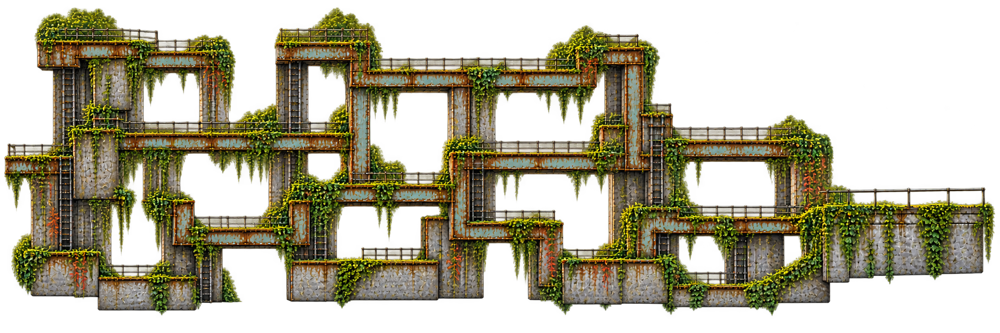
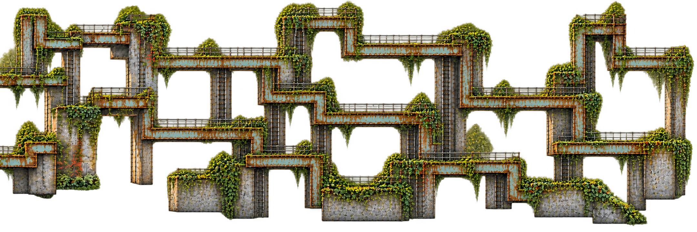
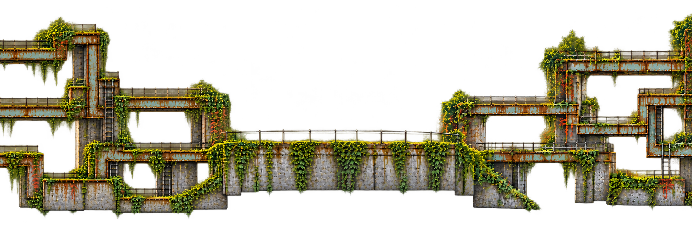
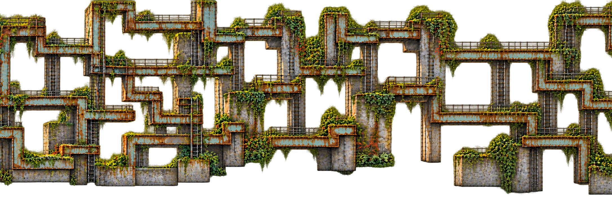
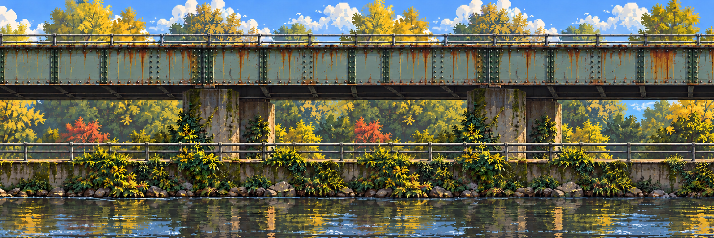
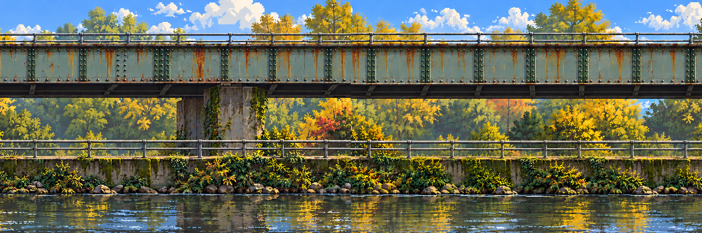

# Rusty Crossings · substantial maze and real layer repairs

**Follow-up:** [the recognizable creek and substantial maze are now combined](../campus-mutation/README.md), with [one photo/stage/layer viewer](../campus-mutation/viewer.html). This page preserves the earlier separate-source seam demonstration.

[Open this earlier study's viewer](viewer.html) · [Exact pipeline / commands](../../../docs/technical/stage-art-pipeline.md) · [Campus collage](../../campus/crossings.md#location-photo-board) · [Stage library](../README.md)

**23 October · current traversal candidate.** Broad pale-green riveted girders, substantial concrete supports, tall shafts, branching platforms, loops and ladders restore the preferred pathfinding-like direction. This supersedes the thin orange traversal pass. The flat camera and collage material/landmark references remain; this is not an accepted game level or complete layered stage.

## Three connected design candidates

| Left extension | Center | Right extension |
| --- | --- | --- |
|  |  |  |

The three full-height alpha plates were generated from the earlier preferred maze and explicitly normalized from native 2172×724 to **2160×720** with nearest-neighbor sampling. Three chunks span **6480×720**. This canonical size is also suitable for the verified API dimension rules; it does not silently redefine the older study's review rectangle. Some original alpha residue remains.

## Repair the actual join, not a different image laid over it

The executable [stage configuration](stage.json) includes two **separate studies**: these traversal plates and the earlier clean location banners. Each has two layer-local joins. The tool crops a 2160×720 staggered context centered on each join, makes an alpha edit mask, then replaces only the central 512-pixel repair band. The remainder stays byte-for-byte identical to the prepared source world. This applies to any configured depth plate, including a separate water layer once authored.

### Maze repair contexts

| Left–center candidate | Center–right candidate |
| --- | --- |
|  |  |

### Clean-location repair contexts

| Left–center candidate | Center–right candidate |
| --- | --- |
|  |  |

The complete generated windows may drift outside the requested band. The compositor discards that drift; it does **not** paste the whole regenerated window or blend away mismatched geometry. Candidates remain native 2172×724 and are explicitly sampled into the canonical context before copying.

The [viewer](viewer.html) reconstructs original and repaired strips from the committed sources, marks actual copied bands and lets you compare both joins. Reproducible wide exports stay in ignored local scratch rather than being committed again.

## What passed, and what still needs review

**Passed:** two-layer/four-join offline replay; zero RGBA pixel changes outside the repair bands; true alpha replacement; source/prompt/mask hashes; ten meaningful offline tests; API adapter dry run retaining `gpt-image-2.5-sunburst`. [Recorded verification](verification.json) · [Prompts and provenance](media-sources.json).

**Not claimed:** perfect visual seams, clean alpha fringes, every-object sprite inventory, collision/route connectivity, seven-depth-layer recomposition, rigs or a finished game. Inspect the patch boundaries as well as the old join; some texture/shape differences remain. The substantial maze and clean straight-bridge location are intentionally shown separately, not falsely combined as one approved scene.

## Grow, insert and reflect

Add a shared chunk ID at either end or in the middle and supply that chunk in each configured layer. Preparation recomputes origins and join jobs; it does not mutate old source files. Water, scenery, traversal and chunk-local anchors must use the same order. The tool currently prepares all joins for each new version rather than incrementally caching neighbors.

Reflections should sample the approved current composition/actors, mirror around a chunk-local waterline and clip to a water mask. They should not bake a fixed maze into the water sprite. The viewer's optional mirror band is a **schematic preview**, not the final water shader or a mirror-world implementation.

## Reproduce

Follow the [exact process and commands](../../../docs/technical/stage-art-pipeline.md). `prepare` creates immutable packets; generation supplies candidates; `apply` performs bounded replacement and writes its report. `submit` is dry by default and invokes the installed imagegen CLI only when explicitly executed. That client's custom-size limitation is documented. No paid API request was made for this study: **built-in image generation** produced these seven candidates; its model ID was not exposed. No model substitution was made.

[Exact final prompts](prompts.json) · [Output and input hashes / normalization](media-sources.json) · [Pipeline issue #14](https://github.com/THD-AI/WinCS/issues/14). Originals, personal screenshots and audio remain outside Git. The earlier thin-bar study remains available for comparison.
